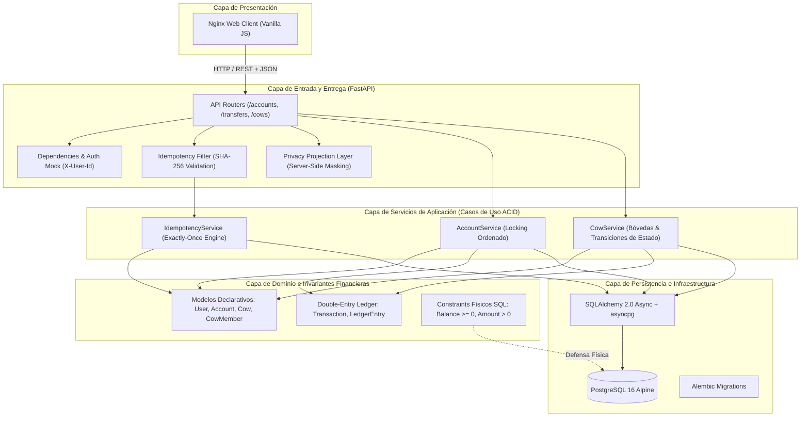

# Arquitectura de Software, Decisiones Técnicas y Defensa de Integridad Financiera

Este documento formaliza la arquitectura del sistema de transferencias P2P y fondos colaborativos ("Vacas") de **HabiCapital**, justificando de manera minuciosa cada decisión técnica, patrón de diseño, matriz de riesgos y tradeoffs adoptados en el proyecto.

---

## 1. Alineación con los Criterios de Evaluación de HabiCapital

El documento oficial del reto técnico establece premisas explícitas:

> *"No estamos haciendo 'una app' para un producto existente... Es una muestra acotada del tipo de problema que resolvemos todos los días en HabiCapital: mover plata de otras personas, sin margen de error."*
>
> *"No es un test genérico: lo diseñamos para ver cómo piensas, no qué memorizaste."*
>
> *"La regla que no se negocia: Esto es plata. Tu sistema no puede perder un peso. Qué puede salir mal y cómo lo proteges es tu decisión. Justifícalo en el README."*
>
> *"Entrevista: 60 minutos de pair programming sobre tu propio código, con un cambio que no anticipaste. Últimos 30 minutos: conversación sobre decisiones y tradeoffs."*

Documentar minuciosamente y justificar el **por qué** detrás de cada abstracción no es un accesorio cosmético: **es el criterio central sobre el cual los ingenieros de HabiCapital evalúan el criterio técnico, la madurez arquitectónica y la capacidad de defender el código en vivo**.

---

## 2. Visión Arquitectónica y Patrón por Capas

El sistema implementa una arquitectura desacoplada inspirada en **Clean Architecture / Arquitectura Hexagonal**, separando estrictamente las reglas de integridad financiera de los mecanismos de entrega (HTTP / UI):



### Principio de Flujo de Dependencias
- Las capas externas (HTTP, FastAPI, Pydantic) dependen de los servicios del Core.
- Los servicios del Core operan sobre las entidades de dominio y el Ledger.
- **La integridad del dinero reside físicamente en la base de datos**; incluso si un bug elude los schemas de FastAPI o la validación en Python, PostgreSQL physically aborta la mutación.

---

## 3. Justificación Minuciosa de Decisiones Arquitectónicas

### 3.1. Base de Datos Relacional (PostgreSQL 16) vs NoSQL / Document DB
- **Decisión:** PostgreSQL con aislamiento transaccional `READ COMMITTED` y bloqueos pesimistas explícitos.
- **Justificación:**
  - En un sistema contable que maneja fondos ajenos, las garantías **ACID reales** son mandatorias.
  - Las bases de datos documentales (MongoDB, DynamoDB) o de consistencia eventual introducen ventanas temporales donde dos operaciones concurrentes pueden leer el mismo saldo y gastarlo simultáneamente (doble gasto).
  - PostgreSQL provee llaves foráneas estrictas (`ON DELETE RESTRICT`), soporte nativo de UUIDs, y la capacidad de declarar `CHECK constraints` evaluados dentro del motor de base de datos.

---

### 3.2. Representación Monetaria: Enteros de 64 bits (`BIGINT`) para Centavos COP
- **Decisión:** Almacenar todo valor financiero como un número entero que representa centavos de peso colombiano (`COP`). Ejemplo: `$50.000 COP` $\to$ `5.000.000` centavos.
- **Por qué NO `FLOAT` / `DOUBLE`:**
  - La representación binaria IEEE-754 introduce imprecisiones de coma flotante (`0.1 + 0.2 = 0.30000000000000004`). En transacciones financieras masivas, esto genera pérdidas o ganancias de fracciones de peso que descuadran el balance del libro mayor.
- **Por qué `BIGINT` sobre `NUMERIC(18, 2)`:**
  - Un entero de 64 bits (`BIGINT` en SQL, `int` en Python) es matemáticamente exacto, consume menos almacenamiento en disco, ofrece operaciones aritméticas a nivel de CPU órdenes de magnitud más veloces, y elimina discrepancias de redondeo entre el ORM y el dialecto SQL.

---

### 3.3. Modelo de Partida Doble (Double-Entry Ledger) con `balance_after`
- **Decisión:** Implementar un libro mayor append-only inmutable donde cada movimiento se descompone en dos asientos atómicos (`DEBIT` y `CREDIT`) y almacena el saldo posterior (`balance_after`).
- **Justificación:**
  1. **Conservación de Masa Monetaria:** Todo débito tiene un crédito equivalente:
     $$\sum \text{Débitos} = \sum \text{Créditos}$$
  2. **Inmutabilidad Absoluta:** Jamás se ejecuta un `UPDATE` o `DELETE` sobre la tabla de transacciones o asientos. Los errores o cancelaciones se registran mediante transacciones compensatorias explícitas.
  3. **Extractos y Auditoría en Tiempo Constante $O(1)$:**
     - En esquemas contables ingenuos, para conocer el saldo histórico en una fecha determinada se debe ejecutar una agregación pesada (`SUM(amount) WHERE created_at <= T`).
     - Al persistir `balance_after` en cada asiento, consultar el extracto de una cuenta o auditar su estado tras una operación es una simple lectura de índice con latencia $O(1)$.

---

### 3.4. Arquitectura de las "Vacas": Cuenta Bóveda Dedicada (`COW_VAULT`)
- **Decisión:** Cada Vaca creada instancia automáticamente una cuenta bancaria dedicada de tipo `COW_VAULT` (`vault_account_id`).
- **Por qué NO un campo mutable `current_amount` en la tabla `cows`:**
  - Mantener un saldo acumulado como columna editable en la tabla de iniciativas es un antipatrón en fintech: si se actualiza la columna pero falla la escritura en el ledger (o viceversa), el saldo virtual de la Vaca deja de coincidir con el dinero real.
  - Al otorgarle a la Vaca su propia cuenta bancaria, **un aporte a la vaca es una transferencia bancaria P2P estándar**:
    $$\text{Cuenta Aportante} \xrightarrow{\text{Transferencia Atómica}} \text{Bóveda de la Vaca}$$
  - Cuando la vaca se desembolsa, se transfiere de la bóveda a la cuenta del titular. Si se cancela, se reembolsa de la bóveda a cada aportante. El saldo total del sistema satisface en todo instante:
    $$\sum \text{Balances}_{\text{cuentas}} = \text{Constante}$$

---

### 3.5. Control de Concurrencia: Bloqueo Pesimista Ordenado vs Optimistic Locking
- **Decisión:** Utilizar `SELECT ... FOR UPDATE` ordenando la adquisición de bloqueos por identificador de cuenta (`id_1 < id_2`).
- **Por qué NO Bloqueo Optimista (`version_id`):**
  - El bloqueo optimista asume que los conflictos son raros. En escenarios de alta concurrencia (ej. 20 amigos aportando a la misma vaca al mismo tiempo o una cuenta recibiendo transferencias simultáneas), el bloqueo optimista rechaza la mayoría de las peticiones con excepciones de colisión de versión, obligando al cliente a reintentar y degradando la experiencia de usuario y la red.
- **Por qué el Ordenamiento Estricto previene Deadlocks:**
  - Si el usuario $A$ transfiere a $B$ y al mismo milisegundo $B$ transfiere a $A$:
    - Hilo 1: Bloquea $A$ y solicita $B$.
    - Hilo 2: Bloquea $B$ y solicita $A$.
    - Resultado sin ordenamiento: **Deadlock circular** detectado por el motor relacional (`deadlock_detected`), abortando una transacción.
  - Al forzar que **siempre se bloquee primero el UUID con menor valor lexicográfico**:
    - Ambos hilos intentan bloquear primero la cuenta con menor ID. Uno gana el lock y el otro espera en cola sin generar ciclos. **Se erradica matemáticamente la posibilidad de deadlock**.

---

### 3.6. Privacidad Resuelta en el Servidor (Server-Side Masking)
- **Decisión:** En Vacas Anónimas (`ANONYMOUS`), la anonimización de los montos individuales se ejecuta en el backend antes de serializar el JSON de respuesta.
- **Justificación:**
  - **Falsa Privacidad en el Cliente:** Si el backend envía los montos individuales en el payload JSON y delega en el frontend de JavaScript la tarea de "ocultarlos con CSS", cualquier participante puede abrir las herramientas de desarrollador del navegador (DevTools / Network Tab) e inspeccionar los aportes de los demás.
  - **Anonimato para Todos (Incluyendo al Creador):** Para cumplir rigurosamente el propósito de una Vaca Privada (evitar presión social en colectas familiares, regalos compartidos o donaciones), **ni siquiera el titular/administrador de la vaca recibe los montos individuales ajenos**. El servidor evalúa:
    ```python
    if cow.visibility_type == CowVisibilityType.ANONYMOUS:
        # El monto individual solo se expone al propio usuario aportante
        monto_visible = m.total_contributed if m.user_id == current_user.id else None
    ```

---

### 3.7. Idempotencia Distribuida con Hash Criptográfico SHA-256
- **Decisión:** Toda mutación financiera requiere o genera una clave de idempotencia validada en la tabla `idempotency_records`.
- **Justificación:**
  - En redes móviles o conexiones inestables, un cliente puede enviar una transferencia, el servidor la procesa con éxito, pero la respuesta HTTP 200 se pierde en el camino debido a un timeout. El cliente reintenta enviar la petición.
  - Sin idempotencia, el usuario sufriría un **doble débito**.
  - Al recibir una clave `Idempotency-Key` ya registrada, el servidor valida el hash SHA-256 del cuerpo de la petición:
    - Si el hash coincide: Retorna inmediatamente la respuesta HTTP original en caché sin tocar el libro mayor.
    - Si el hash difiere (misma clave pero distinto monto o destinatario): Rechaza la solicitud con HTTP 409 (Conflict) para prevenir colisiones o ataques de manipulación.

---

### 3.8. Ciclo de Vida del DDL: Adopción de Alembic para Migraciones Asíncronas
- **Decisión:** Utilizar Alembic en modo asíncrono (`asyncpg`) leyendo la metadata centralizada desde `Base.metadata`.
- **Por qué NO `Base.metadata.create_all()` ni scripts `.sql` manuales:**
  - `create_all()` no altera esquemas existentes, no modifica tipos de columnas, no actualiza índices ni permite operaciones reversibles (`downgrade()`).
  - Los scripts `.sql` manuales carecen de control de versiones atómico, provocan *schema drift* entre ambientes y no dejan registro en la tabla `alembic_version`.
  - Alembic garantiza trazabilidad estricta de cada cambio sobre el catálogo relacional en el historial de Git, requerimiento obligatorio para auditorías de grado bancario (SOC 2, ISO 27001).

---

### 3.9. Trazabilidad Legal y Auditoría Regulatoria en Fondos Colaborativos (SARLAFT / DIAN)
- **Decisión:** Todo movimiento financiero hacia o desde una Vaca es una transacción bancaria real inmutable con partida doble, independientemente de la política de visibilidad.
- **Justificación:**
  - En Vacas Anónimas (`ANONYMOUS`), la anonimización es **estrictamente una máscara en la capa de presentación (UI)** para eliminar la presión social entre pares.
  - **A nivel contable y regulatorio (SARLAFT, Superfinanciera, DIAN), la transacción nunca es anónima**: la base de datos registra de manera obligatoria e inmutable el `user_id` del aportante, el número de cuenta origen, la cuenta bóveda receptora (`COW_VAULT`), el monto en centavos y la marca temporal certificada. La pista de auditoría forense es completa y verificable en cualquier instante.

---

## 4. Matriz de Riesgos y Modos de Falla

| Riesgo / Escenario de Falla | Qué puede salir mal | Cómo lo protege la Arquitectura | Evidencia Verificable |
| :--- | :--- | :--- | :--- |
| **Giro en descubierto (Overdraft)** | Dos débitos concurrentes que superan el saldo disponible. | 1. Bloqueo pesimista `FOR UPDATE` serializa la lectura y deducción.<br>2. Constraint físico `CHECK (balance >= 0)` en PostgreSQL. | Test de 50 peticiones concurrentes: solo pasan las que cubre el saldo; el resto falla limpiamente con HTTP 422. |
| **Deadlock en transferencias bidireccionales** | Dos cuentas transfiriéndose dinero mutuamente en el mismo milisegundo. | Adquisición ordenada de locks por UUID ascendente (`first_id < second_id`). | Test de estrés con 50 transferencias cruzadas simultáneas: 0 errores de deadlock. |
| **Reintentos por timeout de red** | El cliente reintenta una transferencia ya ejecutada, debitando dos veces. | Tabla `idempotency_records` con hash SHA-256 que retorna la respuesta en caché. | Test de envío duplicado con la misma `Idempotency-Key`: solo se registra 1 transacción en el Ledger. |
| **Falla a mitad de transferencia** | El proceso se cae o se pierde la conexión tras debitar la cuenta origen pero antes de acreditar la cuenta destino. | Transacción de base de datos ACID (`BEGIN ... COMMIT`). Si falla un paso, PostgreSQL ejecuta `ROLLBACK` total. | Test de inyección de error mid-transaction: saldo origen y destino permanecen intactos. |
| **Fuga de datos en Vacas Anónimas** | Miembros o creador descubren cuánto aportó un participante ajeno. | Serialización Pydantic en el backend asigna `amount = None` a montos de terceros. | Test de API: aserción estricta de que el payload JSON carece de montos individuales ajenos. |


## 5. Documentación Detallada de la Fase 1: Servicios Transaccionales y Migraciones

Para un análisis formal y matemático de la prevención de deadlocks por ordenamiento lexicográfico, la deduplicación con SHA-256 y la arquitectura contable de las cuentas bóveda, consultar el documento complementario:
👉 **[Decisiones Técnicas, Integridad Financiera y Prevención de Deadlocks — Fase 1](FASE1_DECISIONES.md)**

---

## 6. Documentación Detallada de la Fase 2: Capa API, Autenticación Mock y Serialización de Privacidad

Para la demostración matemática de cero fugas de información (*Zero Mutual Information*), el ciclo de vida de transacciones limpias (`get_db_session`), la deduplicación criptográfica de idempotencia y el arnés de pruebas ASGI en memoria, consultar el documento complementario:
👉 **[Decisiones Técnicas, Capa API y Serialización de Privacidad — Fase 2](FASE2_DECISIONES.md)**

