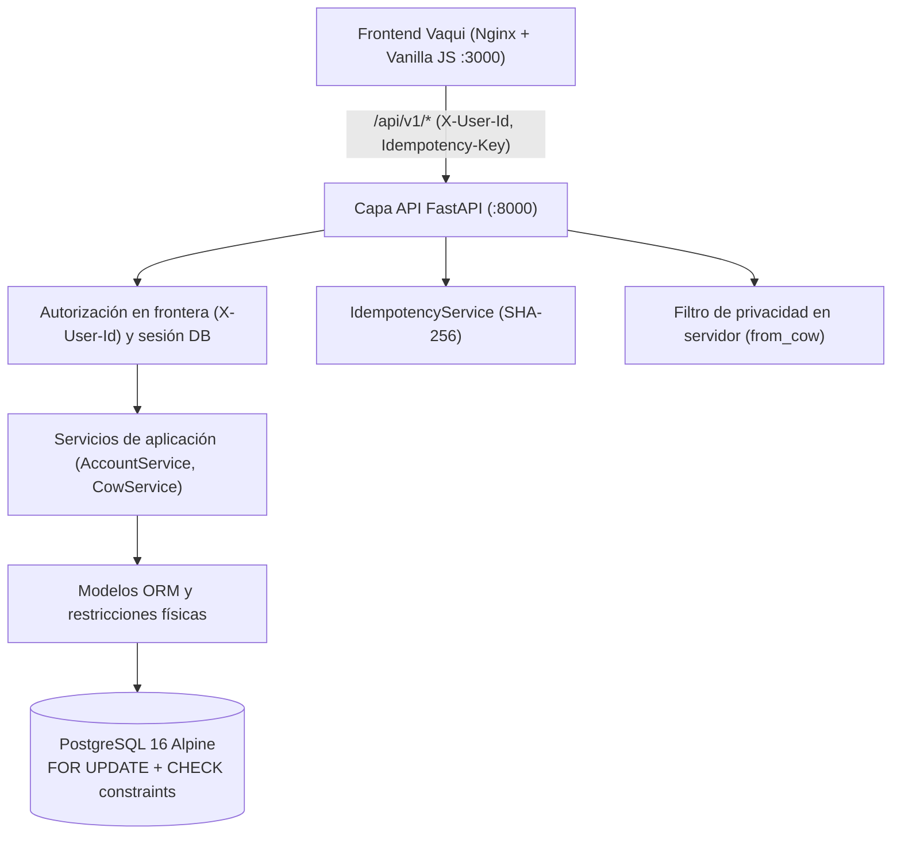

# Arquitectura y Decisiones Técnicas — HabiReto (Vaqui)

Este documento resume cómo organicé el proyecto, por qué elegí cada tecnología y cómo protegí el flujo del dinero para que no se pierda ni se duplique un solo peso.

---

## 1. Enfoque del proyecto

El reto de HabiCapital pide construir un sistema para mover plata entre personas sin fricción, manteniendo contexto real detrás de cada movimiento y sin margen de error contable. Sobre el núcleo obligatorio (crear cuenta, recargar saldo simulado, transferir entre cuentas, consultar saldo e historial) construí **Vaqui**, que suma fondos colaborativos (**Vaquitas**) con cuentas bóveda propias, llaves cortas estilo Bre-B (`@ABC123`) y privacidad real en el servidor para colectas anónimas.

Todo el código busca ser fácil de leer, probar y modificar en vivo, evitando complejidad innecesaria.

---

## 2. Estructura del código (Arquitectura Hexagonal en Monolito Modular)

Organicé el backend siguiendo una **arquitectura hexagonal** aplicada a un monolito modular con separación clara de responsabilidades:

- **Capa API (`src/habireto/api/`):** Recibe las peticiones HTTP, valida esquemas con Pydantic, verifica quién hace la petición (`X-User-Id`), controla la idempotencia y aplica los filtros de privacidad antes de responder.
- **Capa de Servicios (`src/habireto/services/`):** Contiene las reglas de negocio y las operaciones transaccionales (`AccountService`, `CowService`, `IdempotencyService`, `SeedService`), sin depender de HTTP.
- **Capa de Modelos y Persistencia (`src/habireto/models/`, `alembic/`):** Define las tablas, las relaciones y las restricciones físicas en PostgreSQL.

Elegí este enfoque frente a microservicios porque para el alcance del reto permite trabajar rápido, mantener las reglas financieras aisladas de la web y entender o modificar cualquier parte del flujo sin la complejidad de coordinar varios servicios separados.

---

## 3. Decisiones principales y su justificación

### 3.1. Python + FastAPI y Frontend sin frameworks pesados
Elegí **Python** con **FastAPI** porque es un lenguaje con el que me siento muy cómodo, se lee bien y permite validar contratos de entrada y salida desde el primer momento con Pydantic. En el frontend usé HTML, Tailwind CDN y JavaScript modular servido con Nginx para invertir el mayor tiempo posible en la lógica financiera del backend en lugar de configurar empaquetadores o herramientas complejas.

### 3.2. PostgreSQL (Relacional vs. NoSQL)
Elegí **PostgreSQL** porque es gratuito, confiable y ofrece **transacciones ACID reales**, llaves foráneas estrictas y consistencia inmediata. Descarté una base de datos NoSQL porque en modelos pensados para consistencia eventual o sin transacciones relacionales estrictas entre varias tablas resulta mucho más riesgoso evitar lecturas desactualizadas, dobles gastos o transferencias dejadas a medias.

### 3.3. Números exactos en lugar de punto flotante
Nunca usé `float` ni `double` para representar dinero por los errores de redondeo propios de la coma flotante. PostgreSQL ofrece tipos exactos como `NUMERIC` para precisión decimal y enteros de 64 bits (`BIGINT`), que fue el que implementé en las columnas monetarias (`balance`, `amount`, `balance_after`, `target_amount`, `total_contributed`) para manejar pesos colombianos (`COP`) enteros sin decimales ni problemas de redondeo.

### 3.4. Libro mayor de partida doble con `balance_after`
Cada operación financiera genera un registro maestro en `transactions` y sus asientos inmutables (`DEBIT` y `CREDIT`) en `ledger_entries`. Nunca se actualizan ni se borran filas del historial: si una Vaquita se cancela, se crean transacciones nuevas de reembolso. Guardar `balance_after` en cada asiento permite consultar el historial de saldos directamente sin recalcular sumas históricas sobre toda la tabla.

### 3.5. Cuentas bóveda para las Vaquitas (`COW_VAULT`)
En lugar de guardar un campo editable `current_amount` dentro de la tabla `cows`, cada Vaquita crea automáticamente una cuenta propia de tipo `COW_VAULT` en `accounts`. Así, aportar a una Vaquita es una transferencia normal hacia la bóveda, desembolsar es transferir de la bóveda al creador, y cancelar es devolver de la bóveda a cada aportante. Toda la plata del sistema vive en el mismo lugar y bajo las mismas reglas.

### 3.6. Bloqueos ordenados en base de datos (`SELECT ... FOR UPDATE`)
Para evitar que dos peticiones concurrentes gasten el mismo saldo, uso bloqueos de fila en PostgreSQL (`SELECT ... FOR UPDATE`), que serializan las operaciones sobre una cuenta en lugar de depender de reintentos en el cliente como pasaría con un bloqueo optimista cuando varias personas aportan a la misma Vaquita al tiempo.

Además, cuando una transferencia toca dos cuentas, siempre ordeno los identificadores (`UUID`) de menor a mayor antes de bloquearlas. Así, si dos personas se transfieren dinero al mismo tiempo en direcciones opuestas, ambas piden primero la cuenta menor en vez de quedarse bloqueadas esperando una por la otra.

### 3.7. Doble verificación (Python + Base de Datos)
Todas las reglas críticas se validan en dos capas: primero en Python (Pydantic rechaza montos menores o iguales a cero, los endpoints revisan que `X-User-Id` sea dueño de la cuenta origen y los servicios verifican saldo suficiente) y luego físicamente en PostgreSQL mediante restricciones `CHECK` (`balance >= 0`, `amount > 0`, `balance_after >= 0`, etc.). Incluso si hubiera un bug en Python, la base de datos rechaza saldos negativos.

### 3.8. Privacidad en el servidor para Vaquitas anónimas
En una Vaquita marcada como `ANONYMOUS`, ocultar los aportes individuales solo en el navegador no sirve porque cualquiera puede inspeccionar la respuesta de red en DevTools. Por eso el filtrado ocurre en el backend (`CowDetailResponse.from_cow`): los montos de terceros viajan explícitamente como `null` (incluso para quien creó la Vaquita) y la lista de invitados solo se muestra al creador. Internamente, la base de datos sí conserva la trazabilidad contable completa de cada movimiento.

### 3.9. Idempotencia en operaciones que mueven dinero
Para evitar cobros dobles cuando un cliente reintenta una petición por un fallo o timeout de red, las operaciones mutantes aceptan la cabecera `Idempotency-Key`. El backend guarda el resumen SHA-256 de la petición junto con la respuesta en `idempotency_records` (además de `UNIQUE(idempotency_key)` en `transactions`): si llega el mismo payload con la misma clave, devuelve la respuesta guardada; si cambia el contenido reutilizando la misma clave, responde `HTTP 409 Conflict`.

### 3.10. Migraciones con Alembic
El esquema inicial está versionado en `alembic/versions/001_initial_schema.py` con soporte asíncrono para `asyncpg`, lo que permite rastrear cambios de tablas y restricciones físicas de forma ordenada y reversible (`upgrade` / `downgrade`).

---

## 4. Qué puede salir mal y cómo está cubierto

| Escenario | Qué podría pasar | Cómo se protege |
| :--- | :--- | :--- |
| **Sobregiro concurrente** | Dos transferencias simultáneas intentan gastar el mismo saldo. | `SELECT ... FOR UPDATE` serializa el acceso, Python verifica fondos y PostgreSQL impone `CHECK (balance >= 0)`. |
| **Bloqueo cruzado (deadlock)** | Dos cuentas se transfieren mutuamente al mismo tiempo. | Los bloqueos se adquieren siempre en orden ascendente por `UUID`. |
| **Reintento tras timeout** | El cliente repite una transferencia que ya se ejecutó. | `Idempotency-Key` + SHA-256 devuelve la respuesta original sin duplicar el débito. |
| **Falla a mitad de operación** | Ocurre un error tras debitar la cuenta origen pero antes de acreditar el destino. | Todo el endpoint corre dentro de una única transacción (`session.begin()`) que hace `ROLLBACK` completo ante cualquier excepción. |
| **Fuga de datos en Vaquita anónima** | Un participante o el creador inspecciona la respuesta HTTP para ver aportes ajenos. | El backend envía `null` en los montos de terceros y oculta `members` a los demás participantes. |

---

## 5. Documentos por fase

- [DATA_MODEL.md](DATA_MODEL.md) — Tablas, relaciones y restricciones físicas.
- [FASE1_DECISIONES.md](FASE1_DECISIONES.md) — Bloqueos ordenados, bóvedas `COW_VAULT`, libro mayor y Alembic.
- [FASE2_DECISIONES.md](FASE2_DECISIONES.md) — Capa API, `X-User-Id`, privacidad en servidor, idempotencia y cliente ASGI.
- [FASE3_DECISIONES.md](FASE3_DECISIONES.md) — Pruebas de concurrencia, conservación de dinero y simulador en memoria.
- [FASE4_DECISIONES.md](FASE4_DECISIONES.md) — Frontend Vaqui (Terra), llaves `@ABC123`, proxy Nginx y semillado demo.
- [AI_WORKFLOW.md](AI_WORKFLOW.md) — Flujo de trabajo y herramientas usadas con IA.
