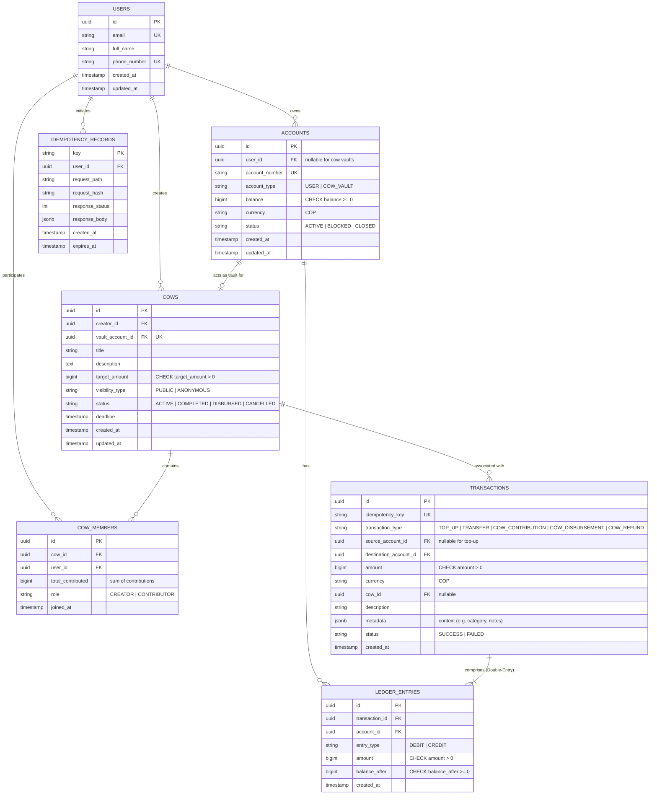

# Modelo de Datos e Integridad Financiera — HabiReto

Este documento especifica la arquitectura del modelo de datos relacional para el sistema de transferencias P2P de HabiCapital, el soporte contable de partida doble (Double-Entry Ledger) y el diseño del producto diferenciador **"Vacas" (Fondos Colaborativos)**.

---

## 1. Principios de Integridad Financiera

El sistema maneja dinero real. Rige la premisa fundamental: **el sistema no puede perder ni crear un solo peso**.

1. **Representación Monetaria Exacta**:
   - Todo monto financiero se almacena como un entero de 64 bits (`BIGINT`) representando centavos de peso colombiano (`COP`).
   - Ejemplo: `$50.000 COP` $\to$ `5000000` centavos.
   - Prohibido el uso de tipos de coma flotante (`FLOAT`, `DOUBLE`).
   - Se valida a nivel de schema y constraint que todo monto de transferencia, recarga o aporte sea estrictamente positivo ($amount > 0$).

2. **Control Físico de Sobregiro**:
   - La tabla `accounts` contiene un constraint físico de integridad:
     ```sql
     CONSTRAINT chk_account_balance_non_negative CHECK (balance >= 0)
     ```
   - La base de datos misma rechaza físicamente cualquier débito que deje la cuenta en números rojos, actuando como defensa en profundidad ante cualquier fallo en la capa de aplicación.

3. **Prevención de Deadlocks por Concurrencia**:
   - Todas las operaciones multi-cuenta adquieren bloqueos pesimistas (`SELECT ... FOR UPDATE`) ordenando los identificadores de menor a mayor (`account_id_1 < account_id_2`).

4. **Inmutabilidad Contable (Append-Only Ledger)**:
   - Los registros de transferencias y asientos contables son inmutables. Nunca se actualiza (`UPDATE`) ni elimina (`DELETE`) un registro histórico.
   - Toda reversión o compensación se registra como una nueva transacción vinculada a la transacción original.

5. **Idempotencia**:
   - Cada mutación financiera requiere un header o parámetro `Idempotency-Key` respaldado en la tabla `idempotency_records`.
   - Peticiones repetidas retornan exactamente la misma respuesta calculada previamente sin re-ejecutar asientos contables.

---

## 2. Diferenciador: "Vacas" (Fondos Colaborativos)

Una **Vaca** es un fondo transitorio administrado por un titular (`creator_id`) para recaudar un monto objetivo entre múltiples usuarios mediante transferencias directas atómicas.

### Arquitectura Contable de una Vaca
Para garantizar la conservación de saldos ($\sum \text{Balances}_{\text{final}} = \sum \text{Balances}_{\text{initial}}$), cada Vaca posee una **cuenta bóveda propia** (`vault_account_id` con tipo `COW_VAULT`).
- **Aporte a la Vaca**: Transferencia atómica `Cuenta Usuario` $\to$ `Bóveda de la Vaca`.
- **Desembolso/Liquidación**: Transferencia atómica `Bóveda de la Vaca` $\to$ `Cuenta Titular / Destino`.
- **Cancelación/Reembolso**: Transferencias atómicas de reversión de la bóveda hacia cada aportante original.

### Políticas de Visibilidad y Privacidad

| Tipo de Visibilidad | Barra de Progreso Global | Lista de Miembros | Visibilidad de Montos Individuales |
| :--- | :--- | :--- | :--- |
| **Abierta / Pública (`PUBLIC`)** | Visible para todos | Visible con nombres | **Visible para todos**: cada participante ve exactamente quién aportó cuánto. |
| **Privada / Anónima (`ANONYMOUS`)** | Visible para todos | Visible con nombres | **Estrictamente oculta para terceros e incluso para el Creador**. Solo el propio aportante ve su monto personal. |

> [!IMPORTANT]
> **Privacidad Absoluta en Vacas Anónimas**:
> En modo anónimo, **ni siquiera el creador/administrador de la vaca puede ver los montos individuales aportados**. El creador únicamente ve el saldo acumulado global, el progreso hacia la meta y los nombres de los participantes que se unieron. Esto elimina por completo la presión social y el sesgo en colectas sorpresa, regalos o donaciones.

---

## 3. Diagrama Entidad-Relación (ERD)



---

## 4. Especificación Detallada de Tablas

### 4.1. `users`
Almacena las identidades del sistema.
- `id` (UUID, PK): Identificador único.
- `email` (VARCHAR 255, UNIQUE, NOT NULL): Correo electrónico.
- `full_name` (VARCHAR 255, NOT NULL): Nombre del titular.
- `phone_number` (VARCHAR 50, UNIQUE, NOT NULL): Teléfono móvil utilizado para resolver destinatarios de transferencias.
- `created_at` / `updated_at` (TIMESTAMPTZ, NOT NULL).

### 4.2. `accounts`
Almacena el estado financiero y balance de cada cuenta (cuentas de usuario o bóvedas de vacas).
- `id` (UUID, PK).
- `user_id` (UUID, FK `users.id`, NULLABLE): Propietario de la cuenta (las bóvedas de vacas pueden referenciar al creador o gestionarse a través de la entidad `cows`).
- `account_number` (VARCHAR 32, UNIQUE, NOT NULL): Identificador contable / IBAN simulado.
- `account_type` (VARCHAR 20, NOT NULL): `'USER'` o `'COW_VAULT'`.
- `balance` (BIGINT, NOT NULL, DEFAULT 0): Balance en centavos.
  - Constraint: `CHECK (balance >= 0)`.
- `currency` (VARCHAR 3, NOT NULL, DEFAULT `'COP'`).
- `status` (VARCHAR 20, NOT NULL, DEFAULT `'ACTIVE'`).
- `created_at` / `updated_at` (TIMESTAMPTZ, NOT NULL).

### 4.3. `cows`
Representa los fondos colaborativos administrados.
- `id` (UUID, PK).
- `creator_id` (UUID, FK `users.id`, NOT NULL): Usuario titular y administrador de la vaca.
- `vault_account_id` (UUID, FK `accounts.id`, UNIQUE, NOT NULL): Cuenta bóveda dedicada donde reposa la plata recaudada.
- `title` (VARCHAR 120, NOT NULL): Nombre de la vaca (ej. "Regalo Matrimonio Laura", "Arriendo Noviembre").
- `description` (TEXT, NULLABLE).
- `target_amount` (BIGINT, NOT NULL): Meta de recaudación en centavos.
  - Constraint: `CHECK (target_amount > 0)`.
- `visibility_type` (VARCHAR 20, NOT NULL): `'PUBLIC'` o `'ANONYMOUS'`.
- `status` (VARCHAR 20, NOT NULL, DEFAULT `'ACTIVE'`): `'ACTIVE'`, `'COMPLETED'`, `'DISBURSED'`, `'CANCELLED'`.
- `deadline` (TIMESTAMPTZ, NULLABLE): Fecha límite opcional de recaudo.
- `created_at` / `updated_at` (TIMESTAMPTZ, NOT NULL).

### 4.4. `cow_members`
Registro de miembros participantes y aportes acumulados por vaca.
- `id` (UUID, PK).
- `cow_id` (UUID, FK `cows.id` ON DELETE CASCADE, NOT NULL).
- `user_id` (UUID, FK `users.id`, NOT NULL).
- `total_contributed` (BIGINT, NOT NULL, DEFAULT 0): Total acumulado aportado por el usuario.
  - Constraint: `CHECK (total_contributed >= 0)`.
- `role` (VARCHAR 20, NOT NULL, DEFAULT `'CONTRIBUTOR'`): `'CREATOR'` o `'CONTRIBUTOR'`.
- `joined_at` (TIMESTAMPTZ, NOT NULL).
- Constraint de unicidad: `UNIQUE (cow_id, user_id)`.

### 4.5. `transactions`
Registro inmutable del evento de transferencia financiera.
- `id` (UUID, PK).
- `idempotency_key` (VARCHAR 255, UNIQUE, NULLABLE).
- `transaction_type` (VARCHAR 30, NOT NULL): `'TOP_UP'`, `'TRANSFER'`, `'COW_CONTRIBUTION'`, `'COW_DISBURSEMENT'`, `'COW_REFUND'`.
- `source_account_id` (UUID, FK `accounts.id`, NULLABLE): `NULL` para depósitos simulados externos (`TOP_UP`).
- `destination_account_id` (UUID, FK `accounts.id`, NOT NULL).
- `amount` (BIGINT, NOT NULL): Monto en centavos.
  - Constraint: `CHECK (amount > 0)`.
- `currency` (VARCHAR 3, NOT NULL, DEFAULT `'COP'`).
- `cow_id` (UUID, FK `cows.id`, NULLABLE): Vinculación si la transacción pertenece al contexto de una vaca.
- `description` (VARCHAR 255, NULLABLE).
- `metadata` (JSONB, NOT NULL, DEFAULT `{}`): Contexto enriquecido (motivo social, categoría, desglose).
- `status` (VARCHAR 20, NOT NULL, DEFAULT `'SUCCESS'`).
- `created_at` (TIMESTAMPTZ, NOT NULL).

### 4.6. `ledger_entries`
Libro mayor contable append-only de doble entrada (Double-Entry).
- `id` (UUID, PK).
- `transaction_id` (UUID, FK `transactions.id`, NOT NULL).
- `account_id` (UUID, FK `accounts.id`, NOT NULL).
- `entry_type` (VARCHAR 10, NOT NULL): `'DEBIT'` (disminución) o `'CREDIT'` (incremento).
- `amount` (BIGINT, NOT NULL): Monto del asiento.
  - Constraint: `CHECK (amount > 0)`.
- `balance_after` (BIGINT, NOT NULL): Saldo resultante tras aplicar el asiento.
  - Constraint: `CHECK (balance_after >= 0)`.
- `created_at` (TIMESTAMPTZ, NOT NULL).

### 4.7. `idempotency_records`
Almacén de peticiones mutantes para evitar duplicación ante reintentos de red.
- `key` (VARCHAR 255, PK): Llave provista por el cliente (`Idempotency-Key`).
- `user_id` (UUID, FK `users.id`, NOT NULL).
- `request_path` (VARCHAR 255, NOT NULL).
- `request_hash` (VARCHAR 64, NOT NULL): SHA-256 del cuerpo de la petición.
- `response_status` (INTEGER, NOT NULL).
- `response_body` (JSONB, NOT NULL).
- `created_at` (TIMESTAMPTZ, NOT NULL).
- `expires_at` (TIMESTAMPTZ, NOT NULL).
