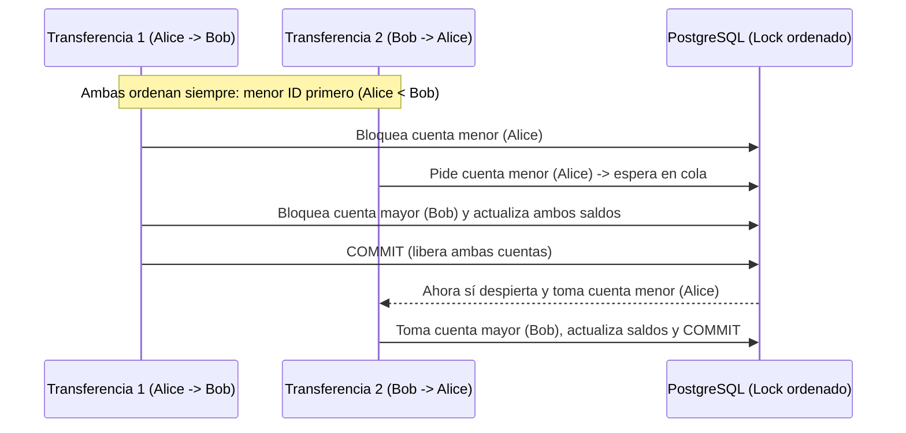

# Fase 1: Decisiones del Core Financiero y Modelo de Datos

En esta primera etapa construí los cimientos del sistema: cómo se guarda la plata, cómo se mueven los saldos entre cuentas y cómo evitamos que dos peticiones al mismo tiempo dañen un balance o se bloqueen entre sí.

Más que buscar términos sofisticados, cada decisión aquí responde a una pregunta práctica: *¿qué podría salir mal si dos personas transfieren dinero al mismo segundo o si algo falla a mitad de camino?*

---

## 1. Dinero en enteros (`BIGINT`) y en pesos colombianos

En Python o JavaScript es muy común usar `float` para números, pero con dinero eso trae un problema clásico: los decimales binarios redondean mal (el típico `0.1 + 0.2 = 0.30000000000000004`). Si empiezas a sumar y restar centavos flotantes, tarde o temprano aparece o desaparece un peso sin explicación.

Para cortar ese problema de raíz decidí guardar todos los montos en **pesos colombianos enteros (`BIGINT` en PostgreSQL e `int` en Python)**.

- **Por qué enteros y no decimales con coma:** En Colombia las transferencias cotidianas y las vacas entre amigos se manejan en pesos completos (`50.000 COP`, `20.000 COP`). Trabajar con enteros en `BIGINT` elimina los errores de redondeo, hace que las sumas sean exactas y evita problemas de conversión.
- **Validación en entrada:** Tanto los esquemas de entrada como las restricciones en la base de datos exigen que cualquier transferencia, recarga o aporte sea estrictamente mayor a `0 COP`.

---

## 2. Prevención de bloqueos mutuos (deadlocks) ordenando los locks

Imagina que Alice le transfiere a Bob y, en ese mismo instante, Bob le transfiere a Alice:

- El proceso A bloquea primero la cuenta de Alice y luego pide bloquear la de Bob.
- El proceso B bloquea primero la cuenta de Bob y luego pide bloquear la de Alice.
- Ninguno puede avanzar porque está esperando al otro. Eso es un **bloqueo mutuo (deadlock)**.

### Cómo lo resolví

En `AccountService.transfer` (en [account_service.py](../src/habireto/services/account_service.py)), antes de tocar cualquier saldo, comparo los identificadores de las dos cuentas involucradas y siempre bloqueo **primero el `id` menor y después el `id` mayor** usando `SELECT ... FOR UPDATE` (`with_for_update()`).

Como todos los procesos siguen exactamente la misma regla de orden (`first_id < second_id`), nunca se forma un círculo de espera: uno termina primero, libera los bloqueos y el otro entra justo después con los saldos ya actualizados.

También descarté usar `asyncio.Lock` o candados en memoria de Python porque solo sirven dentro de un mismo proceso. Si el backend corre con varios workers o contenedores, dos peticiones distintas ignorarían el candado de memoria y podrían gastar el mismo saldo dos veces. Dejar el bloqueo en PostgreSQL garantiza consistencia real sin importar cuántas instancias atiendan tráfico.

---

## 3. Cada Vaquita tiene su propia cuenta bóveda (`COW_VAULT`)

Al diseñar las Vaquitas había dos caminos:

1. Llevar la plata de la Vaquita solo como un número guardado en una tabla `cows` (descontando al usuario y anotando "en teoría" cuánto lleva la vaca).
2. Crear una cuenta bancaria interna dedicada (`AccountType.COW_VAULT`) para cada Vaquita cuando se crea.

Elegí la **segunda opción** en `CowService.create_cow` (en [cow_service.py](../src/habireto/services/cow_service.py)):

- **La plata siempre vive en una sola tabla:** Tanto las cuentas de los usuarios (`AccountType.USER`) como las bóvedas de las vaquitas (`AccountType.COW_VAULT`) son registros de `accounts`. No hay dinero "suelto" en otro lugar.
- **Movimientos simétricos:** Cuando alguien aporta a una Vaquita, no desaparece plata del usuario; simplemente sale de su cuenta `USER` y entra a la cuenta `COW_VAULT` de esa Vaquita.
- **Cierre flexible (`disburse`, `finish_cow` y `cancel`):**
  - Si la Vaquita ya juntó dinero y el creador la cierra o desembolsa (`disburse` o `finish_cow`), el saldo completo pasa de la cuenta `COW_VAULT` a la cuenta `USER` del creador, conservando `total_raised` para que el historial siga mostrando cuánto se recolectó.
  - Si la Vaquita se cierra con `0 COP` mediante `finish_cow`, pasa a estado finalizado limpiamente sin mover saldos innecesarios.
  - Si se cancela (`cancel`), se devuelve exactamente lo que aportó cada participante desde la bóveda hacia sus cuentas originales.

---

## 4. Historial append-only e inmutable (`ledger_entries`)

En un sistema financiero no basta con guardar el saldo actual (`balance`), porque si alguien pregunta *"¿por qué tengo este saldo hoy?"*, un número aislado no lo explica. Además, si editas o borras movimientos viejos, pierdes el rastro ante cualquier reclamo o error.

Por eso todas las operaciones quedan registradas en pares inmutables dentro de `transactions` y `ledger_entries`:

- **Nunca se editan ni se borran filas históricas:** Un movimiento nuevo agrega filas nuevas (`DEBIT` en quien envía, `CREDIT` en quien recibe), acompañadas de `balance_after` y un campo `metadata_json` con el contexto (por ejemplo, a qué Vaquita pertenece o quién inició la operación).
- **Si algo falla a mitad de la operación, se revierte todo:** Todo corre dentro de una única transacción de base de datos. Si ocurre un error después de restar en la cuenta origen pero antes de sumar en la destino, PostgreSQL deshace todo automáticamente (`ROLLBACK`).

---

## 5. Idempotencia para evitar cobros repetidos

En una aplicación real o desde un celular con mala señal, es muy normal que el usuario toque el botón dos veces o que el navegador reintente una petición si se demoró la red. Si el backend ejecuta la misma transferencia dos veces, le descuenta el doble al usuario.

Para evitarlo, las rutas que mueven dinero o modifican estado exigen el encabezado `Idempotency-Key` respaldado por la tabla `idempotency_records`:

1. Antes de ejecutar la operación, se busca esa llave junto con la identidad del usuario.
2. Si la llave es nueva, se guarda el hash SHA-256 del cuerpo de la petición, se ejecuta la operación y se almacena la respuesta.
3. Si llega otra petición con la misma llave y el mismo contenido, el sistema **no vuelve a mover dinero**: devuelve directamente la respuesta que ya había guardado.
4. Si alguien intenta reutilizar una misma llave pero cambiando los datos (por ejemplo, cambiando el monto o el destinatario), el hash SHA-256 no coincide y el sistema rechaza la petición con error.

---

## 6. Doble barrera de validación (Python + PostgreSQL)

Decidí no confiar únicamente en las validaciones del código Python:

1. **Primera barrera (Esquemas y Servicios):** Pydantic valida tipos, montos mayores a cero y formatos como el teléfono colombiano de 10 dígitos empezando en `3` (`validate_colombian_phone`). Los servicios verifican permisos, estados de cuenta y fondos suficientes antes de operar.
2. **Segunda barrera (Base de datos):** Las tablas declaran restricciones físicas como `CHECK (balance >= 0)` en `accounts` y `CHECK (amount > 0)` en `ledger_entries`. Incluso si hubiera un bug futuro en la aplicación, PostgreSQL rechaza guardar un saldo negativo.

---

## 7. Migraciones con Alembic y arranque rápido

El esquema inicial de las 7 tablas y sus restricciones quedó versionado en [001_initial_schema.py](../alembic/versions/001_initial_schema.py).

Al mismo tiempo, para que quien evalúe el proyecto pueda levantarlo con un solo `docker compose up` sin comandos manuales extra, dejé en el `lifespan` de [app/main.py](../app/main.py) la creación automática de tablas (`Base.metadata.create_all`) junto con `SeedService.seed_all` para cargar los 3 usuarios de prueba iniciales (`@ALI111`, `@BOB222`, `@CHA333`). En un entorno productivo real, este arranque automático se reemplazaría por ejecutar `alembic upgrade head` como paso previo del despliegue.
