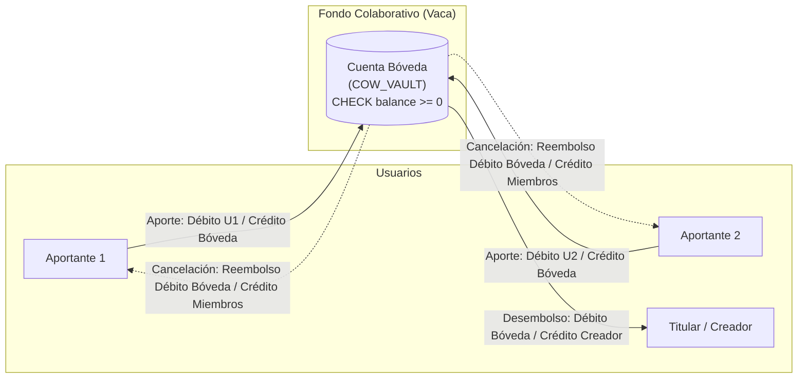

# Decisiones Técnicas, Integridad Financiera y Prevención de Deadlocks — Fase 1

Este documento formaliza minuciosamente las decisiones de arquitectura de software, modelos matemáticos de concurrencia y principios contables aplicados en la **Fase 1 (Servicios Transaccionales ACID y Migraciones)** de **HabiReto**.

---

## 1. Prevención Matemática de Deadlocks (Bloqueo Pesimista Ordenado)

### 1.1. El Problema del Interbloqueo Circular en Finanzas
En un sistema de transferencias P2P o fondos colaborativos de alta concurrencia, múltiples hilos ejecutan transacciones simultáneas que afectan a pares de cuentas compartidas.

Si el usuario $A$ transfiere a $B$ mientras simultáneamente $B$ transfiere a $A$:
1. Transacción 1 (Hilo 1, $A \to B$): Adquiere bloqueo exclusivo de fila (`SELECT ... FOR UPDATE`) sobre la cuenta $A$, y solicita bloqueo sobre $B$.
2. Transacción 2 (Hilo 2, $B \to A$): Adquiere bloqueo exclusivo de fila sobre la cuenta $B$, y solicita bloqueo sobre $A$.
3. **Resultado sin ordenamiento:** Ambos hilos quedan esperando indefinidamente el recurso retenido por el otro (**Deadlock circular**). PostgreSQL detecta el ciclo mediante su daemon de `deadlock_timeout` y aborta una de las dos transacciones de manera arbitraria (`ERROR: deadlock detected`), degradando la experiencia del usuario.

### 1.2. Demostración Matemática de Prevención (Condiciones de Coffman)
Para que ocurra un interbloqueo (*deadlock*) en un sistema concurrente, deben cumplirse simultáneamente las cuatro **Condiciones de Coffman** (1971):
1. **Exclusión mutua:** Las cuentas se bloquean en modo exclusivo (`FOR UPDATE`).
2. **Retención y espera (Hold and Wait):** Un hilo retiene el lock de la primera cuenta mientras espera el lock de la segunda.
3. **No expropiación (No Preemption):** Un lock adquirido no puede ser revocado arbitrariamente por otro hilo.
4. **Espera circular (Circular Wait):** Existe una cadena cerrada de procesos $\{P_0, P_1, \dots, P_n\}$ tal que $P_i$ espera un recurso retenido por $P_{i+1}$, y $P_n$ espera por $P_0$.

**Teorema:**
> *Al imponer una relación de orden total estricta y universal sobre el conjunto de todos los recursos protegibles, la condición de espera circular es matemáticamente imposible.*

**Demostración aplicada a HabiReto:**
Definimos sobre el conjunto de identificadores universales de cuentas $\mathcal{A} = \{ \text{UUID} \}$ una relación de orden total lexicográfico:
$$a_i < a_j \iff \text{hex}(a_i) < \text{hex}(a_j)$$

Regla de Adquisición de Locks:
Para cualquier operación que requiera mutar dos cuentas con identificadores $u, v \in \mathcal{A}$ ($u \neq v$):
$$\text{first\_id} = \min(u, v), \quad \text{second\_id} = \max(u, v)$$

Todo hilo en el sistema ejecuta la adquisición de bloqueos exclusivamente en la secuencia:
1. `SELECT ... FROM accounts WHERE id = first_id FOR UPDATE;`
2. `SELECT ... FROM accounts WHERE id = second_id FOR UPDATE;`

Supongamos por contradicción que existe un ciclo de espera $P_1 \to P_2 \to \dots \to P_n \to P_1$. Para que $P_i$ espere a $P_{i+1}$, $P_{i+1}$ debe haber adquirido un recurso con identificador $k_{i+1}$ que $P_i$ necesita, mientras $P_i$ retiene $k_i$. Dado que todos los procesos adquieren recursos en orden estrictamente creciente:
$$k_1 < k_2 < \dots < k_n < k_1 \implies k_1 < k_1 \quad (\text{Contradicción})$$

Por lo tanto, **el grafo de asignación de recursos es estrictamente un grafo acíclico dirigido (DAG)**. El deadlock queda erradicado a nivel determinista sin necesidad de reintentos ciegos.

```mermaid
graph TD
    subgraph SinOrden["Sin Ordenamiento (Deadlock Circular)"]
        H1["Hilo 1 (A -> B)"] -->|Lock| A1["Cuenta A"]
        H2["Hilo 2 (B -> A)"] -->|Lock| B1["Cuenta B"]
        H1 -.->|Espera Lock| B1
        H2 -.->|Espera Lock| A1
    end

    subgraph ConOrden["Con Ordenamiento Lexicográfico (Serialización Limpia)"]
        H3["Hilo 1 (A -> B)"] -->|Compite por min(A,B)| LockMin["Lock Cuenta menor (ej. A)"]
        H4["Hilo 2 (B -> A)"] -->|Compite por min(A,B)| LockMin
        LockMin -->|El ganador adquiere| LockMax["Lock Cuenta mayor (ej. B)"]
    end
```

---

## 2. Arquitectura Contable de las "Vacas": Cuenta Bóveda Dedicada (`COW_VAULT`)

### 2.1. El Antipatrón del "Saldo Mutable en Tabla de Campañas"
En aplicaciones no financieras, es habitual modelar iniciativas de recaudo colaborativo añadiendo una columna editable a la entidad de la iniciativa:
```sql
-- ANTIPATRÓN FINANCIERO:
ALTER TABLE cows ADD COLUMN current_amount BIGINT DEFAULT 0;
```
Este diseño presenta fallas críticas:
1. **Desincronización de Saldo (Split-Brain Contable):** Si se actualiza `current_amount += aporte` pero falla la escritura en el libro mayor contable (o viceversa), el saldo virtual de la Vaca deja de coincidir con el dinero real disponible.
2. **Violación del Principio de Partida Doble:** El dinero "desaparece" de la cuenta del usuario pero no ingresa a ninguna cuenta bancaria física real; queda como un número flotante en una tabla auxiliar.
3. **Imposibilidad de Auditoría Financiera $O(1)$:** No existe una cuenta contable contra la cual emitir un extracto bancario oficial con balances intermedios.

### 2.2. La Solución de HabiReto: Cuentas Bóveda Oficiales
En **HabiReto**, cada Vaca instanciada genera automáticamente una cuenta bancaria dedicada de tipo `AccountType.COW_VAULT` (`vault_account_id`).

Esta decisión unifica todo el sistema bajo un único modelo contable homogéneo:
- **Un aporte a una Vaca es una transferencia P2P estándar:**
  $$\text{Cuenta Aportante} \xrightarrow{\text{Transferencia Atómica}} \text{Cuenta Bóveda de la Vaca}$$
- **La Bóveda está sujeta a los mismos controles estrictos:**
  - `CHECK (balance >= 0)` físico en PostgreSQL.
  - Bloqueo pesimista ordenado (`FOR UPDATE`).
  - Asientos de partida doble inmutables en `ledger_entries`.



---

## 3. Conservación de Masa Monetaria en Desembolsos y Reembolsos

### 3.1. Teorema de Conservación de Saldos
En todo instante de tiempo $t$, la suma total de saldos de todas las cuentas del sistema ($\mathcal{S}$) satisface la ecuación de balance invariable:
$$\sum_{a \in \mathcal{S}} \text{Balance}(a)_t = \sum_{a \in \mathcal{S}} \text{Balance}(a)_0 + \sum \text{Depósitos Externos} - \sum \text{Retiros Externos}$$

### 3.2. Desembolso Total (`disburse`)
- **Regla:** Solo el titular (`creator_id`) puede liquidar los fondos de la vaca cuando su estado es `ACTIVE` o `COMPLETED` y el saldo de la bóveda es estrictamente positivo ($balance > 0$).
- **Mecanismo:**
  1. Se bloquea la cuenta bóveda y la cuenta personal del creador en orden lexicográfico.
  2. Sea $M = \text{vault\_account.balance}$.
  3. Se debita $\Delta_{\text{vault}} = -M$ (dejando `vault_account.balance = 0`).
  4. Se acredita $\Delta_{\text{creator}} = +M$.
  5. Se asienta `Transaction(type=COW_DISBURSEMENT, amount=M)` con sus dos `LedgerEntry` correspondientes.
  6. Se actualiza `cow.status = CowStatus.DISBURSED`.
- **Invariante:** $\Delta_{\text{vault}} + \Delta_{\text{creator}} = -M + M = 0$.

### 3.3. Cancelación con Reembolsos Compensatorios Exactos (`cancel_and_refund`)
Si una Vaca no cumple su objetivo o es dada de baja por su creador antes del desembolso, el sistema garantiza la devolución exacta a cada participante.

- **Mecanismo:**
  1. Se bloquea la cuenta bóveda con `FOR UPDATE`.
  2. Se consultan todos los registros de miembros con aporte acumulado strictly positive ($total\_contributed > 0$).
  3. Para cada miembro $i$:
     - Se bloquea la cuenta personal del miembro $i$.
     - Sea $R_i = \text{member}_i.\text{total\_contributed}$.
     - Se debita de la bóveda: $\text{vault.balance} \leftarrow \text{vault.balance} - R_i$.
     - Se acredita a la cuenta del miembro: $\text{member\_acc}_i.\text{balance} \leftarrow \text{member\_acc}_i.\text{balance} + R_i$.
     - Se genera `Transaction(type=COW_REFUND, amount=R_i)`.
     - Se asientan los asientos contables de `DEBIT` y `CREDIT`.
     - Se restablece $\text{member}_i.\text{total\_contributed} = 0$.
  4. Al finalizar la iteración sobre todos los miembros:
     $$\text{vault.balance}_{\text{final}} = \text{vault.balance}_{\text{inicial}} - \sum_{i=1}^n R_i = 0$$
  5. Se actualiza `cow.status = CowStatus.CANCELLED`.
- **Garantía:** Cero centavos perdidos, cero centavos duplicados, y auditoría completa de cada reversión en el libro mayor.

---

## 4. Libro Mayor de Partida Doble (Double-Entry Ledger) con `balance_after`

### 4.1. Por qué Persistir `balance_after`
En arquitecturas contables elementales, para saber el saldo de una cuenta en una fecha histórica $T$ se realiza una agregación:
```sql
SELECT SUM(CASE WHEN entry_type = 'CREDIT' THEN amount ELSE -amount END)
FROM ledger_entries
WHERE account_id = :account_id AND created_at <= :T;
```
Este enfoque tiene graves desventajas:
- **Latencia $O(N)$ creciente:** A medida que la cuenta acumula miles de movimientos, generar extractos o validar saldo degrada el rendimiento de la base de datos.
- **Riesgo de inconsistencia temporal:** En sistemas de alta concurrencia, realizar agregaciones dinámicas sin locks puede leer estados a medio confirmar.

**Solución en HabiReto:**
Persistir `balance_after` directamente en cada fila de `ledger_entries` bajo la restricción `CHECK (balance_after >= 0)`:
1. **Auditoría y Extractos $O(1)$:** El saldo histórico exacto tras un movimiento determinado está precalculado e indexado.
2. **Trazabilidad Forense Inmediata:** Cualquier discrepancia en la serie temporal de saldos ($balance\_after_{k} \neq balance\_after_{k-1} \pm amount$) se detecta mediante una consulta lineal simple sin re-ejecutar sumas completas.

---

## 5. Idempotencia Distribuida con Hash Criptográfico SHA-256

### 5.1. El Riesgo del Reintento de Red en Transferencias
En redes móviles o conexiones de baja calidad, es común que una petición mutante (transferencia de fondos) sea procesada exitosamente en el backend, pero la conexión se interrumpa antes de que el cliente reciba la respuesta HTTP 200. Ante el timeout, el cliente (o su lógica de retry automático) reenvía la petición.

Sin un mecanismo de idempotencia estricto:
- La cuenta origen sufriría un **doble débito** indebido.

### 5.2. Arquitectura de Dos Capas de HabiReto
HabiReto protege las mutaciones financieras en dos niveles complementarios:

1. **Capa Relacional (`transactions.idempotency_key UNIQUE`):**
   - La tabla `transactions` cuenta con un constraint de unicidad sobre `idempotency_key`. Si dos transacciones intentan persistirse concurrentemente con la misma clave, PostgreSQL aborta una de ellas con violación de llave única.
2. **Capa de Aplicación y Servicio (`IdempotencyService` & `idempotency_records`):**
   - Se serializa el cuerpo de la solicitud en formato canónico determinista (`json.dumps(..., sort_keys=True)`) y se computa su digest SHA-256 (`request_hash`).
   - Si la clave ya existe con **idéntico hash**: Retorna de inmediato la respuesta serializada previa (`response_body` y `response_status`) **sin tocar los saldos ni el ledger contable**.
   - Si la clave ya existe con **diferente hash**: Se detecta una colisión o reutilización ilícita de clave para otra operación. Se rechaza con `IdempotencyConflictError` (HTTP 409 Conflict).

---

## 6. Defensa en Profundidad: Restricciones Físicas vs Lógica de Aplicación

| Capa de Control | Mecanismo | Qué Previene | Cuándo Actúa |
| :--- | :--- | :--- | :--- |
| **Capa de Entrada (API)** | Validación de Schemas Pydantic | Inyecciones, tipos de datos inválidos, valores nulos o montos negativos en el payload. | Antes de invocar los servicios de negocio. |
| **Capa de Servicios** | `if account.balance < amount: raise InsufficientFundsError` | Validación de reglas de negocio y montos disponibles en memoria. | Durante la ejecución del caso de uso. |
| **Capa de Concurrencia** | `SELECT ... FOR UPDATE` ordenado por UUID | Condiciones de carrera y deadlocks entre transacciones simultáneas. | En el motor relacional antes de mutar filas. |
| **Capa de Persistencia Físico** | `CONSTRAINT ck_accounts_balance_non_negative CHECK (balance >= 0)` | **Defensa física inquebrantable**: Aborta físicamente la transacción si cualquier bug de código intentase dejar un saldo en rojo. | Al momento de ejecutar el `UPDATE/INSERT` en PostgreSQL. |
