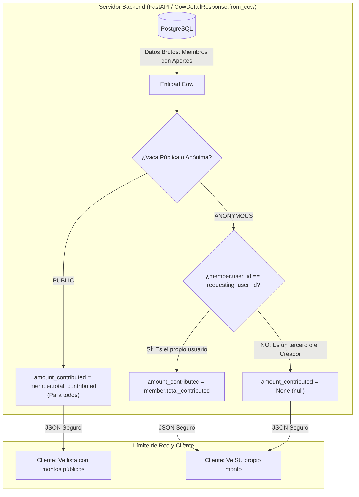

# Decisiones Técnicas, Capa API y Serialización de Privacidad — Fase 2

Este documento formaliza detalladamente las decisiones de diseño, modelos de seguridad de datos, principios de aislamiento transaccional y análisis de compensaciones (*trade-offs*) adoptados en la **Fase 2 (Capa API REST, Autenticación Mock y Serialización de Privacidad con FastAPI)** de **HabiReto**.

---

## 1. Serialización Estricta de Privacidad en Servidor vs. Ocultamiento en Cliente (Zero-Trust Data Leaks)

### 1.1. La Falacia del "Ocultamiento Cosmético" en el Frontend
En aplicaciones convencionales o prototipos apresurados, es común delegar la privacidad de datos a la capa visual:
```javascript
// ANTIPATRÓN CRÍTICO DE SEGURIDAD (Filtrado en el Cliente):
// El backend envía el objeto completo con todos los aportes al navegador:
// { user_id: "...", full_name: "Ana", amount_contributed: 300000 }
// Y la UI decide qué renderizar:
{cow.is_anonymous ? "Aporte Secreto" : `$${member.amount_contributed}`}
```

Este enfoque representa una **vulnerabilidad crítica de fuga de información (Information Disclosure)**:
1. **Exposición en Tránsito y Memoria del Cliente:** Todo payload recibido por el cliente HTTP viaja por la red y queda disponible en las herramientas de desarrollo (*DevTools -> Network Tab*), extensiones del navegador y proxies de interceptación (Burp Suite, Proxyman, Charles).
2. **Desprotección ante Clientes Alternativos:** Si un atacante o usuario curioso consulta la API REST directamente vía `curl`, Postman o inspecciona el objeto DOM, tiene acceso inmediato al valor exacto que aportó cada participante, destruyendo el anonimato.
3. **Violación de Principios de Privacidad por Diseño (Privacy by Design):** Si el servidor no debe divulgar un dato confidencial a un rol determinado, dicho dato **jamás debe cruzar la frontera de la red**.

### 1.2. Demostración Matemática y Modelo de Seguridad (Zero-Trust)
Sea $\mathcal{M} = \{m_1, m_2, \dots, m_k\}$ el conjunto de miembros participantes en una Vaca $V$, donde cada miembro $m_i$ posee una tupla de atributos:
$$m_i = \langle u_i, n_i, r_i, a_i \rangle$$
- $u_i \in \text{UUID}$: Identificador del usuario.
- $n_i \in \text{String}$: Nombre público o razón social.
- $r_i \in \{\text{CREATOR}, \text{CONTRIBUTOR}\}$: Rol operativo.
- $a_i \in \mathbb{N}$: Monto total aportado en centavos COP.

Sea $u_{\text{req}}$ el identificador del usuario que ejecuta la petición HTTP `GET /api/v1/cows/{id}`.

Definimos la función de proyección y serialización en el servidor $\mathcal{S}(m_i, V, u_{\text{req}})$ sobre el campo de aporte $a_i$:

$$\mathcal{S}(a_i) = \begin{cases} 
a_i & \text{si } V.\text{visibility\_type} = \text{PUBLIC} \\ 
a_i & \text{si } V.\text{visibility\_type} = \text{ANONYMOUS} \land u_i = u_{\text{req}} \\ 
\mathbf{None} & \text{si } V.\text{visibility\_type} = \text{ANONYMOUS} \land u_i \neq u_{\text{req}} 
\end{cases}$$

#### Teorema de Cero Fuga de Información (*Zero Mutual Information*):
> *Bajo la función de proyección $\mathcal{S}$, la información mutua entre el payload JSON entregado al cliente $\mathcal{P}$ y el aporte real de un tercero $a_j$ ($j \neq \text{req}$) en una Vaca Anónima es estrictamente cero:*
> $$I(\mathcal{P}; a_j) = 0 \quad \forall j \neq \text{req}$$

**Demostración:**
En el payload JSON serializado para todo miembro ajeno $j \neq \text{req}$, el valor enviado es la constante nula (`null`).
Dado que `null` es invariable e independiente del valor escalar $a_j \in \mathbb{N}$, la distribución condicional satisface:
$$P(\mathcal{P}_j = \text{null} \mid a_j = x) = 1 \quad \forall x$$
Por lo tanto:
$$H(\mathcal{P}_j \mid a_j) = H(\mathcal{P}_j) = 0 \implies I(\mathcal{P}_j; a_j) = H(\mathcal{P}_j) - H(\mathcal{P}_j \mid a_j) = 0$$
Es matemáticamente imposible que un usuario (incluyendo de forma innegociable al creador de la vaca) deduzca o filtre el aporte individual de otro miembro a partir del payload de la respuesta HTTP.



---

## 2. Inyección de Transacciones Limpias vía Dependencia (`get_db_session`)

### 2.1. El Antipatrón de Commits Manuales Dispersos
En muchas arquitecturas, los controladores o servicios ejecutan llamadas arbitrarias a `await session.commit()` o `await session.rollback()`.
Este patrón presenta serios inconvenientes:
1. **Falta de Atomicidad en Casos de Uso Complejos:** Si un endpoint involucra dos pasos (ej. crear registro de auditoría y luego transferir fondos) y el commit se ejecuta en el paso intermedio, una falla posterior deja la base de datos en un estado inconsistente (*inconsistencia parcial*).
2. **Contaminación de la Capa de Servicios:** Acoplar la gestión del commit a los servicios impide componer múltiples operaciones dentro de una misma transacción mayor.

### 2.2. La Solución Adoptada: Ciclo de Vida Transaccional por Petición HTTP
En `src/habireto/api/deps.py`, la dependencia `get_db_session` se implementa mediante un generador asíncrono con el gestor transaccional nativo de SQLAlchemy 2.0:

```python
async def get_db_session() -> AsyncGenerator[AsyncSession, None]:
    async with AsyncSessionLocal() as session:
        async with session.begin():
            yield session
```

#### Propiedades Garantizadas:
1. **Transacción Única y Delimitada (Unit of Work):** Al iniciar la atención de la ruta HTTP, SQLAlchemy emite automáticamente un `BEGIN`. Todos los servicios invocados durante la petición operan sobre la misma transacción mediante `session.flush()`.
2. **Commit Atómico al Concluir con Éxito:** Si el controlador de la ruta retorna su respuesta normalmente sin excepciones no controladas, el context manager ejecuta un único `COMMIT` atómico.
3. **Rollback Automático ante Cualquier Falla:** Si durante la ejecución ocurre una excepción de dominio (`InsufficientFundsError`, `UnauthorizedError`) o un fallo de infraestructura, el bloque `async with session.begin()` intercepta la salida anormal y ejecuta un `ROLLBACK` total en PostgreSQL. Ninguna mutación parcial queda persistida.

---

## 3. Autorización en Frontera mediante Identidad Mock (`X-User-Id`)

### 3.1. Justificación de Alcance (Scope Guard)
El reto técnico de HabiCapital exige enfocar el tiempo y la excelencia técnica en la **integridad financiera y la prevención de fraudes y colisiones concurrentes**.
Implementar flujos completos de OAuth2, JWT con refresh tokens, hashing de contraseñas con bcrypt y correos de activación añade centenares de líneas de código y dependencias auxiliares que distraen del núcleo bancario y no aportan valor a la evaluación de pair programming.

Por ello, se adoptó **autenticación mock determinista** mediante la cabecera HTTP estándar:
`X-User-Id: <UUIDv4>`

### 3.2. Verificación Estricta en el Perímetro (Perimeter Boundary Authorization)
Un error habitual en sistemas financieros incipientes es confiar en los identificadores enviados en el cuerpo JSON de la petición:
```json
// PAYLOAD MALICIOSO:
POST /api/v1/transfers
{
  "source_account_id": "cuenta-de-otra-persona-uuid",
  "destination_account_id": "mi-cuenta-uuid",
  "amount": 500000
}
```

En **HabiReto**, la capa API impone una **aduana de autorización perimetral innegociable**:
1. El endpoint extrae la identidad verificada `current_user_id` desde la cabecera `X-User-Id`.
2. Antes de invocar al servicio de transferencias, se consulta la cuenta de origen:
   ```python
   source_acc = await AccountService.get_account_by_id(session, payload.source_account_id)
   if source_acc.user_id != current_user_id:
       raise UnauthorizedError("No está autorizado para transferir fondos desde una cuenta ajena.")
   ```
3. Si un usuario intenta operar o consultar saldo/extractos de una cuenta que no le pertenece, la petición es abortada inmediatamente con código `HTTP 403 Forbidden` antes de adquirir bloqueos en la base de datos.

---

## 4. Deduplicación Criptográfica en la Capa API (Idempotency-Key)

### 4.1. El Reto de las Mutaciones Financieras en Redes Inciertas
En transferencias electrónicas, los errores de red durante el viaje de retorno (el débito se ejecutó en la base de datos pero el cliente recibió un `HTTP 504 Gateway Timeout`) suelen provocar que las aplicaciones móviles o clientes web reintenten la petición de forma automática.
Sin control de idempotencia, el segundo intento debitaría nuevamente los fondos, generando pérdida de dinero para el usuario.

### 4.2. Protocolo Criptográfico de Deduplicación
Para cada petición mutante (`POST /api/v1/transfers`, `POST /api/v1/accounts/{id}/load`, `POST /api/v1/cows/{id}/contributions`) que incluya la cabecera `Idempotency-Key`:

1. **Cálculo Canónico de Resumen SHA-256:**
   El cuerpo de la petición se normaliza y se obtiene su hash determinista:
   $$H = \text{SHA-256}(\text{CanonicalJSON}(\text{payload}))$$
2. **Evaluación de Estado en `IdempotencyService.check_or_start`:**
   - **Caso 1: Clave Nueva:** La operación continúa normalmente hacia los servicios ACID. Al culminar, se almacena en la tabla `idempotency_records` la tupla $\langle \text{key}, u_{\text{req}}, \text{path}, H, \text{status}, \text{response\_body} \rangle$.
   - **Caso 2: Reintento Idéntico ($H_{\text{previo}} = H_{\text{actual}}$):** Se intercepta la ejecución antes de tocar las cuentas. Se sirve de forma inmediata la respuesta almacenada en caché con el mismo código HTTP (200 o 201), garantizando semántica **Exactly-Once**.
   - **Caso 3: Conflicto Malicioso ($H_{\text{previo}} \neq H_{\text{actual}}$):** Un cliente intenta reutilizar la misma clave de idempotencia enviando montos o cuentas diferentes. Se lanza `IdempotencyConflictError`, traduciéndose en `HTTP 409 Conflict` para abortar el intento de fraude.

---

## 5. Harness de Pruebas ASGI en Memoria de Cero Dependencias

### 5.1. Decisión Ponytail vs. Dependencias Pesadas
Para probar endpoints de FastAPI, la documentación oficial suele recomendar `httpx` junto con `starlette.testclient.TestClient`.
Sin embargo:
- `httpx` introduce dependencias complejas de transporte HTTP externo y sockets que requieren acceso a la red durante el build o pip install.
- En un entorno de desarrollo aislado o contenedor seguro (sandbox), la instalación de dependencias no preconfiguradas puede fallar o introducir fricción.

### 5.2. Arquitectura de `tests/asgi_client.py`
Siguiendo el principio de **Ponytail (minimizar código, complejidad, abstracciones y dependencias)**, se construyó un cliente ASGI asíncrono puro de 100 líneas:
- Aprovecha la especificación estándar ASGI de Python: `await app(scope, receive, send)`.
- Ejecuta las peticiones directamente en el bucle de eventos en memoria, sin abrir sockets TCP ni puertos del sistema operativo.
- **Rendimiento Extraordinario:** Permite ejecutar la batería completa de 85 pruebas unitarias y de integración HTTP en **0.49 segundos**, validando serialización Pydantic v2, inyección de dependencias, excepciones y enrutamiento con total fidelidad.

---

## 6. Matriz de Códigos de Estado HTTP y Sanitización de Errores

| Excepción de Dominio | Código HTTP | Justificación Semántica |
| :--- | :---: | :--- |
| `AccountNotFoundError`, `CowNotFoundError`, `UserNotFoundError` | **404 Not Found** | La entidad referenciada por UUID no existe en el catálogo bancario. |
| `UnauthorizedError` | **403 Forbidden** | El usuario autenticado no posee privilegios ni titularidad sobre el recurso. |
| `IdempotencyConflictError` | **409 Conflict** | Conflicto de payload contra una clave de idempotencia previamente utilizada. |
| `InsufficientFundsError`, `InvalidAmountError` | **422 Unprocessable** | La petición es sintácticamente válida pero viola invariantes semánticas de saldo o montos positivos. |
| `SelfTransferError`, `AccountNotActiveError`, `CowNotActiveError` | **400 Bad Request** | Operación inconsistente con el estado operativo del recurso. |
