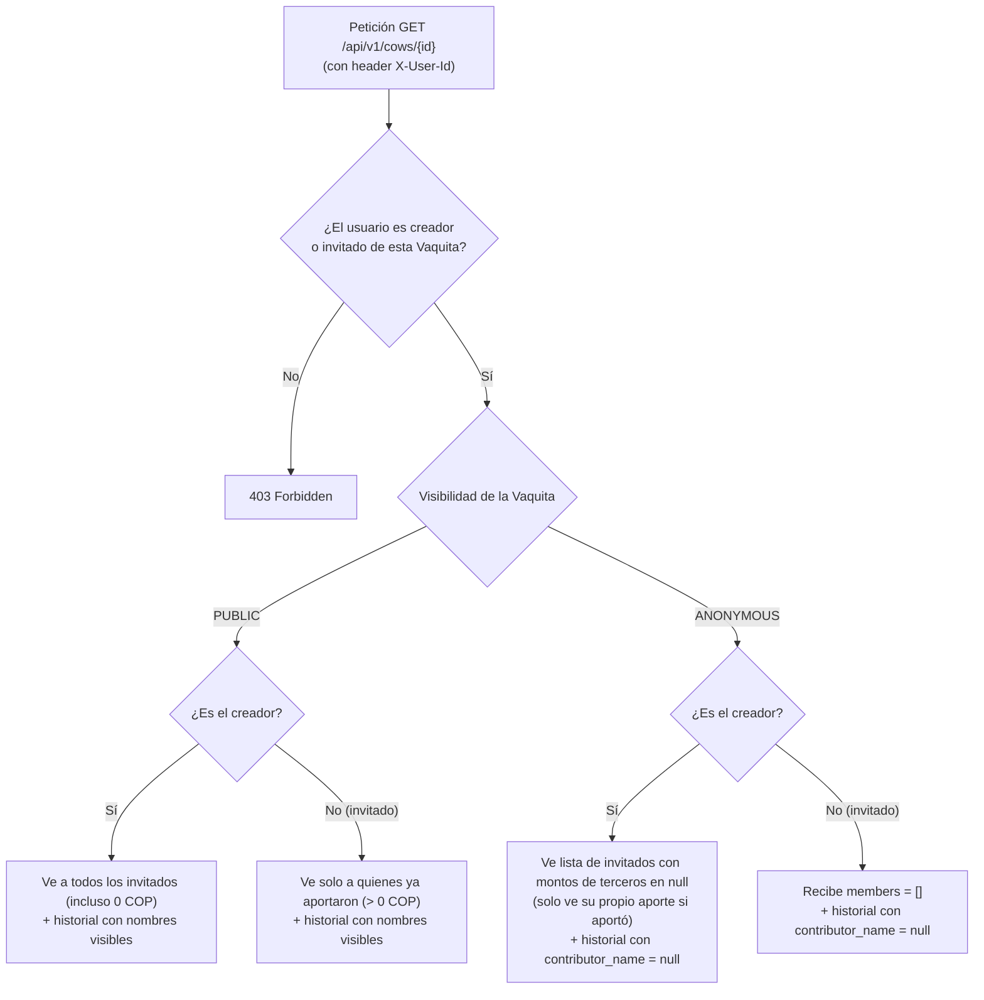

# Fase 2: Privacidad en Vaquitas, Sesión Transaccional y API

En la segunda etapa conecté el núcleo financiero con los endpoints HTTP de FastAPI y resolví uno de los requisitos más delicados del reto: **que la privacidad de las Vaquitas anónimas se garantice desde el servidor y no ocultando datos en el frontend**.

---

## 1. Privacidad Zero-Trust en Vaquitas (`PUBLIC` vs `ANONYMOUS`)

En muchas aplicaciones, cuando quieren hacer algo "anónimo" o "privado", el backend devuelve toda la lista completa en JSON y simplemente el frontend no la dibuja en pantalla. El problema es que cualquier persona abre las DevTools del navegador (pestaña Network) y ve exactamente quién aportó y cuánto puso.

Para evitar esa fuga de datos, implementé el filtro directamente al construir la respuesta en `CowDetailResponse.from_cow` (en [schemas/cow.py](../src/habireto/schemas/cow.py)), aplicando reglas distintas según el tipo de Vaquita y quién hace la consulta:

### Detalle de qué recibe cada rol

- **En una Vaquita pública (`PUBLIC`):**
  - El **creador** ve la lista completa de invitados (incluyendo quiénes todavía llevan `0 COP` porque aún no aportan) y los nombres en el historial de contribuciones.
  - Un **invitado** ve únicamente a los miembros que ya aportaron más de `0 COP` y el historial con sus nombres.
- **En una Vaquita anónima (`ANONYMOUS`):**
  - El **creador** puede ver a quién invitó a la Vaquita, pero el campo `amount_contributed` de los demás participantes llega explícitamente en `null` (solo ve su propio aporte si participó), y cada movimiento en `contributions` trae `contributor_name = null`.
  - Un **invitado** recibe `members = []` y el listado de aportes también con `contributor_name = null`. Así sabe cuánto dinero lleva recaudado la Vaquita en total, pero no puede deducir quién puso cada monto ni quién ha faltado por aportar.

De esta forma, aunque alguien inspeccione la respuesta cruda del servidor en el navegador, la información sensible ni siquiera sale de la API.

---

## 2. Identidad por header (`X-User-Id`) y llaves cortas (`@ABC123`)

Para mantener el foco del reto en el núcleo financiero y no perder tiempo construyendo flujos completos de OAuth2, correos de recuperación o JWT con refresh tokens, la API identifica al usuario activo mediante el encabezado `X-User-Id` resuelto en `get_current_user_id` (en [deps.py](../src/habireto/api/deps.py)).

Sobre esa base agregué dos comodidades pensadas para probar y usar la app sin fricción:

- **Llaves legibles tipo `@ABC123`:** En [schemas/user.py](../src/habireto/schemas/user.py), `compute_user_key` asigna una llave corta a cada usuario (por ejemplo `@ALI111`, `@BOB222` y `@CHA333` para los usuarios demo). Así nadie tiene que copiar y pegar un UUID de 36 caracteres para hacer una transferencia o invitar a una Vaquita.
- **Autorización estricta en backend:** Aunque el cliente mande un `X-User-Id`, todos los servicios validan que esa persona realmente sea dueña de la cuenta origen antes de debitar dinero o tenga rol de creador antes de cerrar, desembolsar o cancelar una Vaquita.

---

## 3. Una sola transacción por petición HTTP (`get_db_session`)

Una duda importante al conectar FastAPI con SQLAlchemy asíncrono es dónde abrir y cerrar las transacciones. Si cada servicio hiciera `commit()` por su cuenta, una operación compuesta podría guardar la mitad de los cambios y fallar en la otra mitad.

En [deps.py](../src/habireto/api/deps.py), la dependencia `get_db_session` abre una sola sesión y una sola transacción (`async with session.begin(): yield session`) para todo el ciclo de la petición HTTP:

- Si el endpoint termina bien, SQLAlchemy hace `commit` automático al salir.
- Si se lanza cualquier excepción de negocio o error inesperado, hace `rollback` completo de forma automática y los manejadores de errores traducen la falla a un mensaje limpio (`400`, `403`, `404`, `409`, etc.) sin filtrar trazas internas ni detalles de la base de datos.

---

## 4. Pruebas reales sin levantar servidor aparte (`tests/asgi_client.py`)

Para probar los endpoints HTTP con sus encabezados (`X-User-Id`, `Idempotency-Key`), códigos de estado y respuestas JSON sin depender de levantar Docker o un puerto TCP en cada ejecución, utilicé el transporte ASGI de `httpx` conectado directamente a la aplicación FastAPI en [tests/asgi_client.py](../tests/asgi_client.py).

Esto permite correr toda la suite de validación (actualmente **98 pruebas** unitarias, de API y de concurrencia) en apenas ~1,3 segundos y detectar al instante errores de contrato o fugas de datos.
