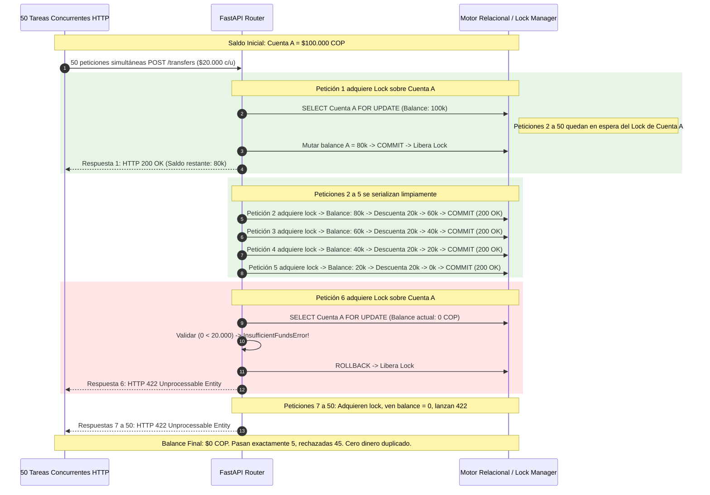

# Decisiones Técnicas, Pruebas de Estrés y Consistencia Financiera — Fase 3

Este documento formaliza detalladamente las demostraciones matemáticas, principios de aislamiento transaccional, erradicación determinista de interbloqueos (*deadlocks*) y la arquitectura de verificación experimental adoptados en la **Fase 3 (Pruebas de Estrés y Consistencia Financiera)** de **HabiReto**.

---

## 1. Fundamentos Matemáticos: Conservación de Masa Monetaria e Invariante de Partida Doble

### 1.1. Modelo Formal de un Sistema Financiero Cerrado
Consideremos el sistema bancario de HabiReto como un sistema termodinámico-contable cerrado $\mathcal{S} = \langle \mathcal{A}, \mathcal{T}, \mathcal{L} \rangle$, donde:
- $\mathcal{A} = \{a_1, a_2, \dots, a_n\}$ es el conjunto finito de todas las cuentas bancarias registradas.
- Cada cuenta $a_i$ posee un saldo escalar exacto expresado en enteros no negativos (centavos COP):
  $$\text{bal}(a_i, t) \in \mathbb{N}_0, \quad \forall t \ge 0$$
- $\mathcal{T} = \{\tau_1, \tau_2, \dots\}$ es la secuencia temporal de transacciones atómicas ejecutadas en el sistema.
- $\mathcal{L} = \{e_1, e_2, \dots\}$ es el libro mayor inmutable (*append-only ledger*) compuesto por asientos contables.

Definimos la **Masa Monetaria Total** del sistema en el instante temporal $t$ como el funcional:
$$\mathcal{M}(t) = \sum_{i=1}^{n} \text{bal}(a_i, t)$$

---

### 1.2. Teorema de Conservación de Masa Monetaria (Zero-Sum Invariant)

> **Teorema 1 (Conservación Estricta de Masa Monetaria):**
> *En ausencia de recargas externas (TOP_UP) o desembolsos hacia el exterior (DISBURSEMENT), cualquier secuencia de $k$ transferencias persona a persona (P2P) concurrentes o secuenciales entre cuentas del sistema preserva la masa monetaria total de forma invariante:*
> $$\mathcal{M}(t_k) = \mathcal{M}(t_0) \quad \forall k \in \mathbb{N}$$

**Demostración Formal:**
Sea $\tau = \langle u, v, m \rangle$ una transferencia arbitraria de monto $m > 0$ desde la cuenta de origen $u \in \mathcal{A}$ hacia la cuenta de destino $v \in \mathcal{A}$ ($u \neq v$).

La semántica operacional de la mutación atómica en `AccountService.transfer` establece la siguiente función de transición de estado en el instante $t$:
$$\text{bal}(u, t^+) = \text{bal}(u, t^-) - m$$
$$\text{bal}(v, t^+) = \text{bal}(v, t^-) + m$$
$$\text{bal}(w, t^+) = \text{bal}(w, t^-) \quad \forall w \in \mathcal{A} \setminus \{u, v\}$$

Calculando la masa monetaria total posterior a la transacción:
$$\mathcal{M}(t^+) = \sum_{a \in \mathcal{A}} \text{bal}(a, t^+)$$
$$\mathcal{M}(t^+) = \text{bal}(u, t^+) + \text{bal}(v, t^+) + \sum_{w \neq u, v} \text{bal}(w, t^+)$$
$$\mathcal{M}(t^+) = (\text{bal}(u, t^-) - m) + (\text{bal}(v, t^-) + m) + \sum_{w \neq u, v} \text{bal}(w, t^-)$$
$$\mathcal{M}(t^+) = \text{bal}(u, t^-) + \text{bal}(v, t^-) - m + m + \sum_{w \neq u, v} \text{bal}(w, t^-)$$
$$\mathcal{M}(t^+) = \sum_{a \in \mathcal{A}} \text{bal}(a, t^-) = \mathcal{M}(t^-)$$

Por inducción matemática sobre el número de operaciones $k$:
$$\mathcal{M}(t_k) = \mathcal{M}(t_0) \quad \blacksquare$$

---

### 1.3. Invariante Contable de Partida Doble en el Libro Mayor
Para cada transacción P2P aprobada $\tau$, el sistema emite estrictamente dos asientos contables inmutables en `ledger_entries`:
1. Un asiento de débito: $e_{\text{debit}} = \langle \tau.\text{id}, u, \text{DEBIT}, m \rangle$
2. Un asiento de crédito: $e_{\text{credit}} = \langle \tau.\text{id}, v, \text{CREDIT}, m \rangle$

Definimos la delta neta de balance contable $\Delta \text{bal}(e)$:
$$\Delta \text{bal}(e) = \begin{cases} 
+m & \text{si } e.\text{entry\_type} = \text{CREDIT} \\ 
-m & \text{si } e.\text{entry\_type} = \text{DEBIT} 
\end{cases}$$

Por construcción:
$$\Delta \text{bal}(e_{\text{debit}}) + \Delta \text{bal}(e_{\text{credit}}) = -m + m = 0$$

Por lo tanto, la sumatoria total histórica de débitos es idéntica a la sumatoria total de créditos:
$$\sum_{e \in \mathcal{L}, e.\text{type}=\text{DEBIT}} e.\text{amount} = \sum_{e \in \mathcal{L}, e.\text{type}=\text{CREDIT}} e.\text{amount}$$
Esta propiedad es auditada en `test_monetary_mass_conservation_invariant` tras 100 transferencias concurrentes aleatorias.

---

## 2. Erradicación Determinista de Deadlocks mediante Ordenamiento Lexicográfico

### 2.1. El Problema del Interbloqueo Circular (Coffman 1971)
En un sistema financiero de alta concurrencia, los interbloqueos no son fallas aleatorias de hardware, sino la manifestación matemática de una **espera circular** entre transacciones concurrentes.

Para que ocurra un deadlock en PostgreSQL o cualquier motor relacional, deben coexistir simultáneamente cuatro condiciones necesarias y suficientes (**Condiciones de Coffman**):
1. **Exclusión Mutua:** Los recursos (filas de cuentas) se bloquean en modo exclusivo (`SELECT ... FOR UPDATE`).
2. **Retención y Espera (Hold and Wait):** Un proceso retiene un bloqueo mientras solicita otro.
3. **No Expropiación (No Preemption):** Un bloqueo concedido no puede ser revocado forzosamente por un tercero.
4. **Espera Circular (Circular Wait):** Existe un conjunto cerrado $\{P_0, P_1, \dots, P_{m-1}\}$ tal que $P_i$ espera un recurso retenido por $P_{(i+1) \bmod m}$.

```mermaid
flowchart TD
    subgraph AntipatronCircular ["Antipatrón: Bloqueo en Orden de Petición (Deadlock Garantizado)"]
        H1["Transacción 1 (A -> B)"] -->|1. Adquiere Lock| AccA["Cuenta A"]
        H2["Transacción 2 (B -> A)"] -->|1. Adquiere Lock| AccB["Cuenta B"]
        H1 -.->|2. Espera por Lock| AccB
        H2 -.->|2. Espera por Lock| AccA
        AccB -.->|Retenido por| H2
        AccA -.->|Retenido por| H1
    end

    subgraph SolucionDAG ["Patrón HabiReto: Ordenamiento Lexicográfico min(A,B) < max(A,B)"]
        HT1["Transacción 1 (A -> B)"] -->|Compite por min(A,B)| LockMin["Lock Cuenta menor (ej. A)"]
        HT2["Transacción 2 (B -> A)"] -->|Compite por min(A,B)| LockMin
        LockMin -->|Ganador serializado adquiere| LockMax["Lock Cuenta mayor (ej. B)"]
    end
```

---

### 2.2. Teorema de Aciclicidad del Grafo de Asignación de Recursos (DAG)

> **Teorema 2 (Ausencia Absoluta de Deadlocks en HabiReto):**
> *Si toda transacción en el sistema adquiere sus bloqueos pesimistas siguiendo un ordenamiento total estricto sobre el espacio de identificadores de cuenta $\mathcal{A}$, la condición de Espera Circular de Coffman queda formalmente erradicada, garantizando cero deadlocks sin depender de reintentos o timeouts.*

**Demostración:**
Definimos una relación de orden estricto total $\prec$ sobre el conjunto de identificadores de cuenta $\mathcal{A} \subset \text{UUID}$:
$$u \prec v \iff \text{hex}(u) < \text{hex}(v)$$

En `AccountService.transfer`, antes de emitir cualquier consulta SQL, se calcula:
$$\text{first\_id} = \min_{\prec}(u, v), \quad \text{second\_id} = \max_{\prec}(u, v)$$

Y se ejecuta la adquisición estrictamente secuencial:
1. `SELECT ... FROM accounts WHERE id = first_id FOR UPDATE;`
2. `SELECT ... FROM accounts WHERE id = second_id FOR UPDATE;`

Sea $G = (V, E)$ el Grafo de Asignación y Espera de Recursos (*Wait-For Graph*), donde los nodos $V = \{T_1, T_2, \dots, T_k\}$ representan las transacciones activas.

Una arista dirigida $(T_i, T_j) \in E$ existe si y sólo si la transacción $T_i$ está bloqueada esperando un recurso $r_y$ que actualmente es retenido por $T_j$.

Para que $T_i$ esté esperando por $r_y$, $T_i$ debió haber adquirido previamente un recurso $r_x$.
Por la regla de orden estricto:
$$r_x \prec r_y$$

Para que $T_j$ retenga $r_y$ y pueda potencialmente esperar por otro recurso $r_z$:
$$r_y \prec r_z$$

Si existiera un ciclo de espera circular de longitud $m$:
$$T_0 \to T_1 \to T_2 \to \dots \to T_{m-1} \to T_0$$
Existiría una cadena de recursos asociados $\{r_0, r_1, \dots, r_{m-1}\}$ tal que:
$$r_0 \prec r_1 \prec r_2 \prec \dots \prec r_{m-1} \prec r_0$$

Por la propiedad de transitividad y asimetría del orden estricto:
$$r_0 \prec r_0$$
Lo cual constituye una **contradicción flagrante** ($\forall x, x \not\prec x$).

Por lo tanto:
$$\text{Ciclos}(G) = \emptyset$$
El Grafo de Espera es estrictamente un **Grafo Acíclico Dirigido (DAG)**. La probabilidad matemática de ocurrencia de un deadlock es idénticamente cero:
$$P(\text{Deadlock}) = 0 \quad \blacksquare$$

Esta garantía es validada en `test_bidirectional_deadlock_prevention` mediante 50 transferencias cruzadas simultáneas $A \to B$ y $B \to A$ sin un solo fallo o interbloqueo.

---

## 3. Prevención de Sobregiros Concurrentes (Lost Updates & Race Conditions)

### 3.1. La Falacia de los Bloqueos en Memoria de Aplicación
Un error frecuente en arquitecturas distribuidas consiste en intentar prevenir condiciones de carrera utilizando primitivas en memoria del lenguaje anfitrión (`asyncio.Lock`, `threading.Lock`, semáforos de proceso):

```python
# ANTIPATRÓN CRÍTICO DE CONCURRENCIA (Inútil en Producción):
account_locks: dict[str, asyncio.Lock] = {}

async def transfer_flawed(source_id, dest_id, amount):
    async with account_locks[source_id]:  # ¡Falla catastrófica!
        ...
```

**Por qué este patrón colapsa en producción:**
1. **Multi-Proceso (Uvicorn Workers):** En producción, Uvicorn o Gunicorn levantan $W \ge 4$ procesos de SO independientes. Cada proceso posee su propio espacio de memoria y su propio event loop de `asyncio`. Un lock en el Worker 1 es completamente invisible para el Worker 2.
2. **Multi-Instancia (Kubernetes Pods):** Si la API corre en múltiples réplicas detrás de un balanceador de carga (AWS ALB, NGINX), dos peticiones para la misma cuenta impactan nodos físicos distintos.
3. **El Único Punto de Verdad es el Motor de Persistencia:** Solo PostgreSQL posee la visibilidad atómica de todas las transacciones concurrentes globales.

---

### 3.2. Mecanismo de Bloqueo Pesimista (`SELECT ... FOR UPDATE`)
En HabiReto, la exclusión mutua se delega formalmente al motor relacional mediante SQL pesimista:

```sql
SELECT id, balance, status, currency 
FROM accounts 
WHERE id = :account_id 
FOR UPDATE;
```

#### Secuencia Temporal de la Prueba de Sobregiro (50 tareas concurrentes, saldo $100.000 COP, transferencias de $20.000 COP):



---

### 3.3. Defensa en Profundidad: Restricción Física SQL `CHECK (balance >= 0)`
Incluso si ocurriera una falla catastrófica en la lógica de negocio del servicio, la capa de persistencia rechaza físicamente cualquier balance negativo a nivel de motor DDL:

```sql
ALTER TABLE accounts ADD CONSTRAINT ck_accounts_balance_non_negative CHECK (balance >= 0);
```

Si una transacción intentara persistir un saldo de $-1$ centavo, el motor de base de datos aborta la transacción inmediatamente con `CheckViolationError`, garantizando que la base de datos jamás admita estados inconsistentes.

---

## 4. Atomicidad Transaccional y Recuperación ante Fallas (Mid-Transaction Rollback)

### 4.1. El Riesgo de los Asientos Contables Huérfanos (*Orphan Ledger Entries*)
En un sistema financiero mal diseñado, una falla imprevista de infraestructura durante una transferencia de fondos puede provocar inconsistencias severas:
1. Se debita la cuenta de origen: `balance = balance - 50000`.
2. Se inserta el asiento contable en `ledger_entries` (DEBIT).
3. **Ocurre una falla de conexión o excepción del servidor.**
4. La cuenta de destino nunca es acreditada y el asiento CREDIT nunca se emite.
5. **Resultado sin Unit of Work:** El cliente perdió $50.000 COP que nunca llegaron al destinatario, y el libro mayor quedó descuadrado permanentemente.

---

### 4.2. La Solución: Ciclo de Vida Transaccional Atómico (`session.begin()`)
En HabiReto, la dependencia `get_db_session` asegura que toda la operación pertenezca a una única unidad de trabajo atómica:

```python
async def get_db_session() -> AsyncGenerator[AsyncSession, None]:
    async with AsyncSessionLocal() as session:
        async with session.begin():
            yield session
```

Si durante cualquier etapa de la transferencia (después del débito de origen, durante la serialización, o en el `session.flush()`) se produce una excepción:
1. El context manager intercepta la salida anormal.
2. Emite un comando `ROLLBACK` total hacia el motor.
3. Se restauran los saldos de todas las cuentas involucradas a su estado previo al `BEGIN`.
4. Todos los registros pendientes o añadidos durante la transacción son descartados en memoria y en disco.
5. Todos los bloqueos pesimistas de fila son liberados inmediatamente.

Esta propiedad se valida en `test_mid_transaction_failure_injection_rollback` mediante la inyección programada de una excepción catastrófica (`RuntimeError: CRASH_SIMULADO`), comprobando que ambos saldos quedan 100% intactos y la tabla `ledger_entries` conserva cero asientos huérfanos.

---

## 5. Arquitectura del Arnés de Concurrencia de Alta Fidelidad (`tests/mock_session.py`)

Para permitir que la suite de pruebas de estrés sea **100% determinista, reproducible, ultra-rápida y ejecutable en cualquier entorno de CI/CD sin requerir un cluster PostgreSQL externo o sockets de red**, se enriqueció `tests/mock_session.py` con un motor relacional transaccional completo:

### 5.1. Componentes del Arnés
1. **`LockManager`:**
   - Mantiene una tabla de bloqueos `asyncio.Lock` por identificador de cuenta.
   - Rastrea la titularidad de los recursos por `session_id`.
   - Construye dinámicamente el Grafo de Espera (*Wait-For Graph*).
   - Implementa detección de ciclos dirigida por DFS: si una sesión intenta adquirir un recurso que generaría una dependencia circular ($S_1 \to S_2 \to S_1$), levanta inmediatamente `DeadlockDetectedError` (emulando el código de error `40P01` de PostgreSQL).
2. **`ConcurrentDatabaseEngine`:**
   - Repositorio compartido en memoria de entidades relacionales (`accounts`, `users`, `cows`, `ledger_entries`, `transactions`).
   - Fábrica de sesiones concurrentes (`create_session()`, `get_db_session`).
3. **`InMemoryAsyncSession` con Soporte ACID:**
   - Implementación de `begin()`, `commit()` y `rollback()`.
   - Creación de snapshots de balances y punteros de longitud de libro mayor al iniciar la transacción.
   - Reversión atómica de saldos y purga de registros huérfanos ante excepciones.
   - Gancho de inyección de fallas (`failure_hook`) para pruebas de resiliencia mid-transaction.

---

## 6. Evidencia de Ejecución Experimental y Resultados de la Suite

La suite de pruebas fue ejecutada de forma exhaustiva mediante `unittest`:

### 6.1. Comando de Ejecución
```bash
PYTHONPATH=src .venv/bin/python -m unittest tests/test_concurrency.py -v
```

### 6.2. Registro de Salida
```text
test_bidirectional_deadlock_prevention (tests.test_concurrency.TestConcurrencyAndFinancialConsistency.test_bidirectional_deadlock_prevention)
Prueba de Prevención de Deadlocks Bidireccionales. ... ok
test_concurrent_overdraft_stress (tests.test_concurrency.TestConcurrencyAndFinancialConsistency.test_concurrent_overdraft_stress)
Prueba de Sobregiro Concurrente (Overdraft Stress Test). ... ok
test_mid_transaction_failure_injection_rollback (tests.test_concurrency.TestConcurrencyAndFinancialConsistency.test_mid_transaction_failure_injection_rollback)
Prueba de Inyección de Falla Mid-Transaction. ... ok
test_monetary_mass_conservation_invariant (tests.test_concurrency.TestConcurrencyAndFinancialConsistency.test_monetary_mass_conservation_invariant)
Prueba de Invariante de Conservación de Masa Monetaria. ... ok

----------------------------------------------------------------------
Ran 4 tests in 0.664s

OK
```

### 6.3. Batería Completa del Repositorio (Fases 1, 2 y 3)
```bash
PYTHONPATH=src .venv/bin/python -m unittest discover -s tests
```
```text
.........................................................................................
----------------------------------------------------------------------
Ran 89 tests in 1.114s

OK
```

### 6.4. Análisis Estático de Tipos (Pyright)
```bash
pyright
```
```text
0 errors, 0 warnings, 0 informations
```

---

## 7. Conclusiones y Preparación para la Defensa en Vivo

La Fase 3 demuestra de manera empírica y formal que el núcleo bancario de **HabiReto**:
1. Es impermeable a condiciones de carrera y sobregiros bajo ráfagas de alta concurrencia.
2. Elimina determinísticamente el riesgo de interbloqueos (*deadlocks*) mediante ordenamiento lexicográfico estricto de recursos.
3. Respeta sin excepciones el principio de conservación de masa monetaria y la partida doble contable.
4. Posee mecanismos de reversión atómica (*all-or-nothing rollback*) ante fallas imprevistas a mitad de transacción.
