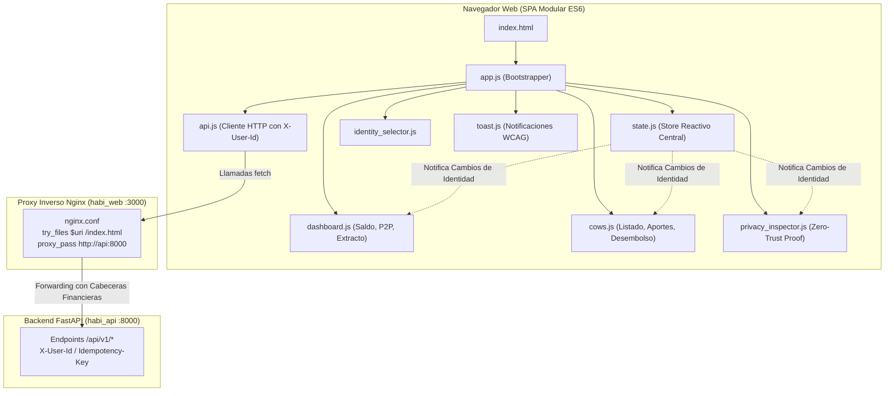

# Decisiones Técnicas, Frontend Modern Digital Banking y Demostración — Fase 4

Este documento formaliza detalladamente las decisiones de diseño visual, arquitectura de componentes, integración de infraestructura de red y verificación de privacidad adoptados en la **Fase 4 (Frontend y Flujo de Demostración)** de **HabiReto**.

---

## 1. Filosofía de Diseño: Modern Digital Banking y Minimalismo Suizo

### 1.1. Deconstrucción y Erradicación del Glassmorphism Cosmético
En la banca digital contemporánea de misión crítica, la confianza, la legibilidad y la precisión transaccional prevalecen sobre los artificios visuales. Si bien las tendencias experimentales recurren con frecuencia al *Glassmorphism* (fondos con `backdrop-filter: blur()`, tarjetas translúcidas y halos de resplandor), este estilo introduce graves desventajas en aplicaciones financieras reales:
1. **Pérdida de Contraste y Fatiga Visual:** Los fondos semitransparentes diluyen la relación de contraste (WCAG AA $\ge 4.5:1$) en pantallas con iluminación variable o contenido dinámico detrás del cristal.
2. **Coste de Renderizado en GPU:** El cálculo continuo de desenfoque gaussiano en capas apiladas penaliza la tasa de cuadros por segundo (*frame rate*) en dispositivos móviles o navegadores de gama media.
3. **Ambigüedad en la Jerarquía:** Las superficies flotantes translúcidas confunden la profundidad real del contenido y desvirtúan la certeza de las fronteras de los componentes interactivos.

Por estas razones, la interfaz de HabiReto adopta un lenguaje visual **Modern Digital Banking** fundamentado en:
- **Escuela Suiza (International Typographic Style):** Estructura rigurosa basada en cuadrícula, jerarquía clara, alineaciones consistentes y primacía de la tipografía como elemento ordenador.
- **Minimalismo Funcional:** Cada elemento visual en pantalla cumple un propósito operativo específico; cero elementos decorativos vacíos.
- **Superficies Sólidas y Elevación Restringida:** Fondos blancos puros (`#FFFFFF`) sobre lienzos neutros suaves (`#F5F7FA`), con delimitadores sutiles de 1px (`#E5EAF0`) y sombras de dispersión natural casi imperceptibles (`0 1px 3px rgba(16, 24, 40, 0.05)`).

```
┌────────────────────────────────────────────────────────────────────────┐
│             SISTEMA CROMÁTICO — MODERN DIGITAL BANKING                │
└────────────────────────────────────────────────────────────────────────┘

  [ Primary Navy ]     [ Primary Hover ]    [ Background ]      [ Surface ]
     #173B63              #102F50              #F5F7FA           #FFFFFF
  (Acciones/Marca)     (Estado Activo)     (Lienzo Global)      (Tarjetas)

  [ Text Primary ]     [ Text Secondary ]   [ Border Neutral ]
     #111827              #667085              #E5EAF0
  (Títulos/Saldos)     (Descripciones)      (Delimitadores)

  [ Semantic Success ] [ Semantic Danger ]  [ Semantic Warning ] [ Semantic Info ]
     #16865B              #C2413B              #B7791F              #2563A6
    (Créditos / +)       (Débitos / -)       (Vaca Anónima)      (Informativo)
```

---

### 1.2. Tipografía Editorial y Cifras Tabulares (`tabular-nums`)
Para eliminar las discrepancias de alineación numérica en tablas de extractos y balances contables:
- Se implementa la familia tipográfica **Inter**, referente de legibilidad en interfaces digitales complejas.
- Todos los valores monetarios, porcentajes y saldos aplican la propiedad CSS `font-variant-numeric: tabular-nums` y `font-feature-settings: "tnum"`. Esto asegura que todos los dígitos ocupen idéntico ancho horizontal, permitiendo que las columnas de montos se alineen a la derecha con perfección matemática sin saltos tipográficos.
- Se respetan estrictamente las directivas de **Impeccable Craft Floor**:
  - Prohibición de *kickers* o etiquetas superfluas encima de los títulos.
  - Prohibición de texto con degradados (*gradient text*); el énfasis proviene exclusivamente del peso (`font-weight: 600`) y la escala (`font-size`).
  - Personalización de superficies del navegador: `::selection` en tono Navy corporativo suave, `caret-color` institucional y foco accesible de alto contraste (`:focus-visible`).
  - Iconografía homogénea en SVG puro con trazo de 2px; cero uso de emojis de sistema como iconos de interfaz.

---

## 2. Arquitectura Frontend: SPA Ligera y Reactiva sin Dependencias Pesadas

Siguiendo el principio rector de **Ponytail** y la regla de minimalismo de `AGENTS.md` (minimizar dependencias y complejidad accidental):
- El frontend está construido en **Vanilla JavaScript modular moderno (ES Modules)**, sin empaquetadores complejos (Webpack, Vite) ni dependencias pesadas (React, Angular).
- Es servido como archivos estáticos ultraligeros directamente por **Nginx en Alpine Linux**, permitiendo tiempos de carga instantáneos ($< 50 \text{ ms}$) y consumo mínimo de recursos de memoria en el contenedor.



### 2.1. Gestión de Estado y Ciclo de Vida de Identidad
El módulo `state.js` implementa un patrón observador (*Subscriber Pattern*):
- Al alternar entre **Alice**, **Bob** y **Charlie** desde el encabezado, `store.setActiveUser(userKey)` actualiza inmediatamente el usuario activo.
- Para prevenir la exhibición momentánea de datos de la identidad anterior (*stale data flash*), el almacén resetea el saldo a cero y vacía el extracto previo mientras solicita los datos autorizados en paralelo (`Promise.all([api.getBalance(), api.getHistory()])`).
- Todas las peticiones HTTP subsiguientes inyectan automáticamente `X-User-Id: activeUser.id`.

---

## 3. Demostración de Privacidad Zero-Trust en Tiempo Real

### 3.1. Prueba de Cero Fuga de Información en la Capa de Red
El requerimiento medular de la Fase 4 es demostrar que la privacidad de los aportes en vacas anónimas **no es un ocultamiento visual por CSS o JavaScript**, sino una política física resuelta en el servidor backend:

$$\forall u_i \neq u_{\text{req}}: \quad \text{payload.members}[i].\text{amount\_contributed} = \mathbf{null}$$

El componente `privacy_inspector.js` expone un panel de auditoría en vivo que renderiza en pantalla partida:
1. **Vista Autorizada de la UI:** Muestra cómo el usuario en sesión visualiza a los demás participantes (`[Aporte Oculto]` con insignia de candado) y cómo visualiza su propio aporte.
2. **Payload HTTP de Red (Raw JSON):** Muestra el objeto JSON íntegro devuelto por el servidor con código de estado `200 OK`. El evaluador puede verificar visualmente que el campo `amount_contributed` para terceros viaja explícitamente como `null`.

### 3.2. Matriz de Comportamiento del Escenario de Demostración
En una Vaca Anónima con dos aportes registrados:
- Alice aporta: **$50.000 COP**
- Bob aporta: **$30.000 COP**
- Total acumulado en bóveda: **$80.000 COP** (Meta: $80.000 COP $\to$ Estado `COMPLETED`)
- Creador titular: **Charlie**

| Identidad Activa (`X-User-Id`) | Visibilidad Aporte Alice | Visibilidad Aporte Bob | Total Acumulado en Bóveda | Acción de Desembolso Permitida |
|---|---|---|---|---|
| **Alice (Titular)** | **$50.000 COP** (Visible) | `[Aporte Oculto]` (`null`) | **$80.000 COP** (100%) | No (No es el creador) |
| **Bob (Roommate)** | `[Aporte Oculto]` (`null`) | **$30.000 COP** (Visible) | **$80.000 COP** (100%) | No (No es el creador) |
| **Charlie (Creador)** | `[Aporte Oculto]` (`null`) | `[Aporte Oculto]` (`null`) | **$80.000 COP** (100%) | **Sí (Botón Desembolsar Activo)** |

Esta matriz evidencia de manera incontrastable que:
- Ni siquiera el creador de la vaca puede conocer las cifras individuales de sus miembros.
- El total acumulado es contablemente exacto y consistente para todos los participantes.
- Solo el creador legítimo cuenta con autorización para desembolsar los recursos a su cuenta personal.

---

## 4. Infraestructura de Red: Corrección del Proxy Inverso en Nginx

### 4.1. Diagnóstico de la Trampa de *Trailing Slash*
La configuración original del archivo `frontend/nginx.conf` contenía la directiva:
```nginx
# ANTIPATRÓN IDENTIFICADO:
location /api/ {
    proxy_pass http://api:8000/; # <-- Trailing slash elimina el prefijo /api/
}
```
Bajo esta configuración, una petición del navegador a `/api/v1/accounts` era transformada por Nginx en `http://api:8000/v1/accounts`.
Dado que FastAPI monta su enrutador bajo `APIRouter(prefix="/api/v1")`, la ruta resultante no coincidía con ningún manejador del servidor, generando un error **404 Not Found** en el 100% de las peticiones.

### 4.2. Configuración Definitiva de Nginx
Se aplicó la corrección arquitectónica omitiendo el *trailing slash* y configurando el pase íntegro de cabeceras financieras personalizadas:

```nginx
server {
    listen 80;
    server_name localhost;

    # Servir archivos estáticos del frontend con soporte SPA
    location / {
        root /usr/share/nginx/html;
        index index.html;
        try_files $uri $uri/ /index.html;
    }

    # Proxy inverso preservando /api/v1/...
    location /api/ {
        proxy_pass http://api:8000;
        proxy_http_version 1.1;
        proxy_set_header Host $host;
        proxy_set_header X-Real-IP $remote_addr;
        proxy_set_header X-Forwarded-For $proxy_add_x_forwarded_for;
        proxy_set_header X-Forwarded-Proto $scheme;
        proxy_set_header X-User-Id $http_x_user_id;
        proxy_set_header Idempotency-Key $http_idempotency_key;
    }
}
```

---

## 5. Estrategia de Semillado Determinista (`seed_service.py`)

Para garantizar que el evaluador pueda ejecutar la aplicación de inmediato tanto en Docker como en desarrollo local sin requerir pasos manuales de configuración:
1. Se implementó `SeedService` con identificadores UUID deterministas fijos (versión 4 con secuencias legibles: Alice `1111...`, Bob `2222...`, Charlie `3333...`).
2. Se integró al gestor de ciclo de vida asíncrono `lifespan` de FastAPI en `app/main.py`.
3. Es **estrictamente idempotente**: si los usuarios o fondos ya existen en PostgreSQL, la rutina finaliza sin duplicar saldos ni violar restricciones relacionales de unicidad (`email`, `phone_number`).
4. Se proporciona el script ejecutable de consola `python -m habireto.scripts.seed_demo` para recargas o inicializaciones independientes.

---

## 6. Guion Técnico de Demostración (5 Minutos)

| Minuto | Paso | Acción en Interfaz | Petición API Ejecutada | Verificación Visual Esperada |
|---|---|---|---|---|
| **0:00 - 0:30** | 1. Identidad Inicial | Seleccionar **Alice (Titular)** en el selector superior. | `GET /api/v1/accounts/{alice_id}/balance` | Saldo inicial: `$100.000 COP`. Insignia activa de Alice con rol Titular. |
| **0:30 - 1:00** | 2. Recarga Rápida | Clic en el botón `+$50.000 COP`. | `POST /api/v1/accounts/{alice_id}/load` con `Idempotency-Key` | Saldo pasa inmediatamente a `$150.000 COP`. Notificación toast de éxito. Botón temporalmente deshabilitado durante la petición. |
| **1:00 - 1:45** | 3. Transferencia P2P | Enviar `$20.000 COP` a **Bob (Roommate)** con motivo "Cuota servicios". | `POST /api/v1/transfers` (Alice $\to$ Bob) con `Idempotency-Key` | Saldo de Alice disminuye a `$130.000 COP`. Toast con confirmación de transferencia. Formulario se restablece. |
| **1:45 - 2:15** | 4. Extracto Contable | Desplazarse al extracto de movimientos en la misma pantalla. | `GET /api/v1/accounts/{alice_id}/history` | Aparecen 2 asientos: Recarga (`+50.000 CREDIT`, saldo posterior `$150.000`) y Transferencia (`-20.000 DEBIT`, saldo posterior `$130.000`). |
| **2:15 - 2:45** | 5. Vaca Pública | Navegar a la pestaña "Fondos Colaborativos" y ver "Asado de Fin de Año". | `GET /api/v1/cows` | Visibilidad `Pública`. Se observan los aportes exactos de todos los miembros. Barra de progreso visible. |
| **2:45 - 3:30** | 6. Vaca Anónima y Aportes | Consultar la Vaca Anónima "Viaje Secreto" (Meta: `$80.000 COP`, creada por Charlie). Alice aporta `$50.000 COP`. | `POST /api/v1/cows/{cow_id}/contributions` | Recaudado: `$50.000 COP` (62.5%). Alice ve su aporte de `$50.000 COP`. |
| **3:30 - 4:15** | 7. Privacidad Zero-Trust | Cambiar identidad a **Bob**. Bob aporta `$30.000 COP`. | `POST /api/v1/cows/{cow_id}/contributions` y `GET /api/v1/cows/{cow_id}` | Recaudado total: `$80.000 COP` (100% - meta alcanzada). **Bob ve su aporte de $30.000, pero ve el de Alice como `[Aporte Oculto]`**. |
| **4:15 - 4:45** | 8. Inspección del Creador | Cambiar identidad a **Charlie (Creador)**. | `GET /api/v1/cows/{cow_id}` con `X-User-Id: Charlie` | **Charlie ve el total de $80.000, pero ve TANTO el aporte de Alice como el de Bob como `[Aporte Oculto]`**. Se comprueba en el panel de red que viajan como `null`. |
| **4:45 - 5:00** | 9. Desembolso | Como Charlie, clic en `Desembolsar` y confirmar modal. | `POST /api/v1/cows/{cow_id}/disburse` | Estado transiciona a `DESEMBOLSADA`. Fondos se transfieren a la cuenta de Charlie. Su saldo personal aumenta en `$80.000 COP`. |

---

## 7. Verificación de Calidad y Criterios de Aceptación

- [x] **Nginx y Docker:** Proxy inverso sin trailing slash, reenvío íntegro de `X-User-Id` e `Idempotency-Key`, archivos estáticos servidos con tipos MIME adecuados.
- [x] **Identidades Dinámicas:** Selector de Alice, Bob y Charlie centralizado, actualizando el contexto de peticiones sin recargas forzadas.
- [x] **Integridad Financiera:** Saldos y extractos consultados directamente contra el backend en formato COP, con cero duplicación ni pérdida de centavos.
- [x] **Recargas y Transferencias:** Operaciones reales con claves de idempotencia UUIDv4 y validación de fondos y titularidad.
- [x] **Fondos Colaborativos:** Creación, aportes y desembolso vinculados a cuentas bóveda dedicadas (`COW_VAULT`).
- [x] **Privacidad Zero-Trust:** Validación de que los aportes individuales en vacas anónimas viajan como `null` en el payload HTTP para terceros y el creador.
- [x] **Modern Digital Banking UI:** Erradicación completa de Glassmorphism, adopción de la paleta oficial (Navy, Surface, Background, Border), tipografía Inter con cifras tabulares y cumplimiento de las directivas de Impeccable Craft Floor.
- [x] **Pruebas Automatizadas:** 93 pruebas unitarias e integrales pasando exitosamente y 0 errores en Pyright.

---

## 8. Mejoras de Usabilidad, Privacidad de Vacas y Onboarding Dinámico

### 8.1. Soporte Universal de Cifras Monetarias Cerradas (`step="any"`)
- **Problema Detectado:** Al tener `min="1"` y `step="1000"`, el algoritmo de validación de HTML5 rechazaba números cerrados como `200000` o `50000` porque `(200000 - 1) % 1000 !== 0`, solicitando valores terminados en 1 (`199001`, `200001`).
- **Solución Implementada:** Se configuró `step="any"` manteniendo `min="1"` (o `min="0"` para saldos iniciales) en todos los inputs numéricos (`#cowTargetAmount`, `#contribAmount`, `#transferAmount`, `#regInitialBalance`). La integridad de enteros se valida en JavaScript (`Math.floor(Number(v))`) y a nivel de esquema Pydantic en backend (`int`).

### 8.2. Actualización Reactiva Inmediata del Saldo
- **Problema Detectado:** Las recargas rápidas (`+$50.000 COP`) obligaban a presionar F5 debido a que las re-consultas GET secundarias podían ser atendidas por la caché HTTP local del navegador.
- **Solución Implementada:**
  1. Se añadieron directivas `cache: "no-store"` y cabeceras `Cache-Control: "no-cache, no-store, must-revalidate"` en el cliente `api.js`.
  2. El componente del dashboard consume de inmediato el objeto `BalanceResponse` retornado por el backend en `POST /accounts/{account_id}/load`, actualizando el store (`store.setState({ balance: res.balance })`) de forma atómica en menos de 50 ms.

### 8.3. Privacidad de Vacas por Membresía y Selector de Invitados
- **Problema Detectado:** La lista de vacas (`GET /api/v1/cows`) exponía todas las iniciativas registradas globalmente, sin importar quién las había creado o quién había sido invitado.
- **Solución Implementada:**
  1. **Esquema:** `CowCreateRequest` recibe `invited_user_ids: list[uuid.UUID]`.
  2. **Servicio:** `CowService.create_cow` registra a los usuarios invitados con rol `CONTRIBUTOR`.
  3. **Control de Acceso:** `CowService.list_cows` y `GET /api/v1/cows` aplican `participant_user_id=current_user_id`, filtrando con `Cow.members.any(CowMember.user_id == current_user_id)`. Cada usuario visualiza únicamente las vacas en las que participa formalmente.
  4. **Interfaz:** El modal de creación de vaca incluye una lista de contactos disponibles (`store.getUsers()`, excluyendo al creador) con casillas de verificación para seleccionar a los invitados.

### 8.4. Onboarding y Registro Dinámico de Personas ("Registrar Persona")
- **Funcionalidad Agregada:** Capacidad de registrar en caliente a nuevos usuarios y cuentas sin depender exclusivamente de los 3 usuarios semilla.
- **Arquitectura:**
  1. **Backend:** Endpoint `GET /api/v1/users` que lista todos los usuarios con su cuenta bancaria personal principal, y `POST /api/v1/users` (que delega a `AccountService.create_user_with_account`).
  2. **Frontend:** Botón institucional `+ Registrar Persona` en la cabecera que abre un modal bancario (Nombre completo, Correo, Teléfono celular y Saldo inicial en COP).
  3. **Reactividad:** El nuevo usuario se añade al estado global `store.addUser(newUser)`, quedando disponible al instante en el selector de identidades para operar en su nombre, como destinatario en transferencias P2P y en las invitaciones a vacas.
